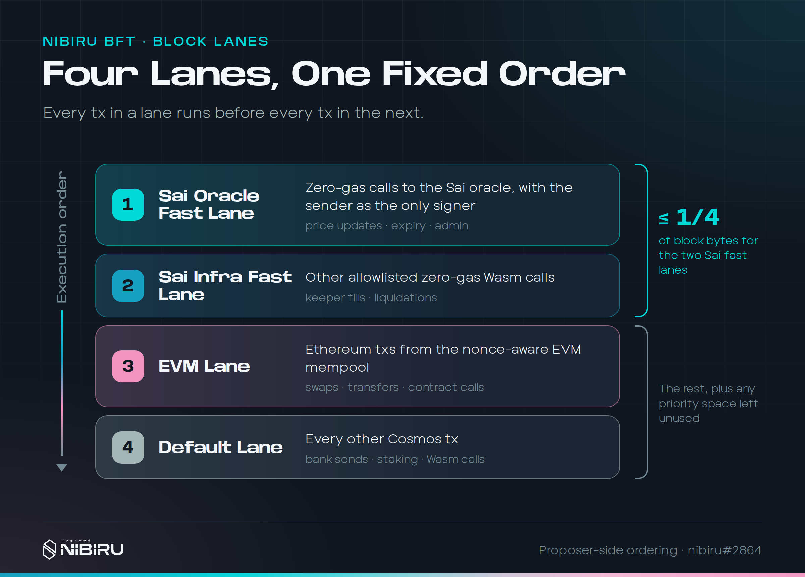
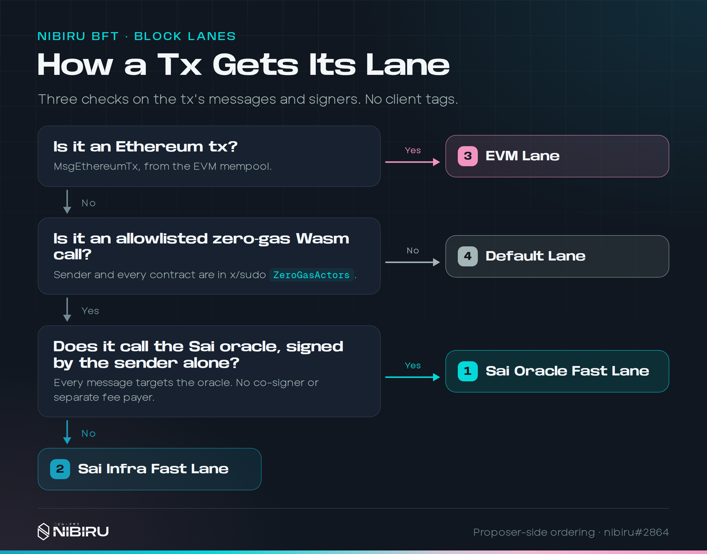
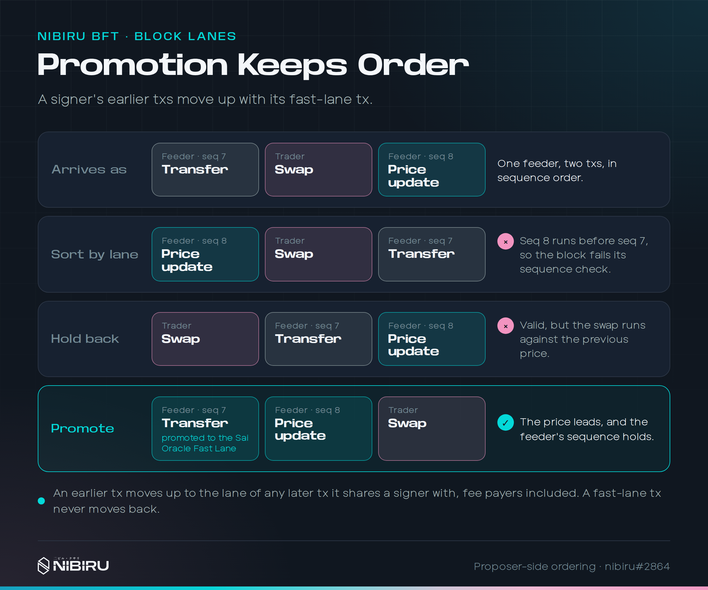
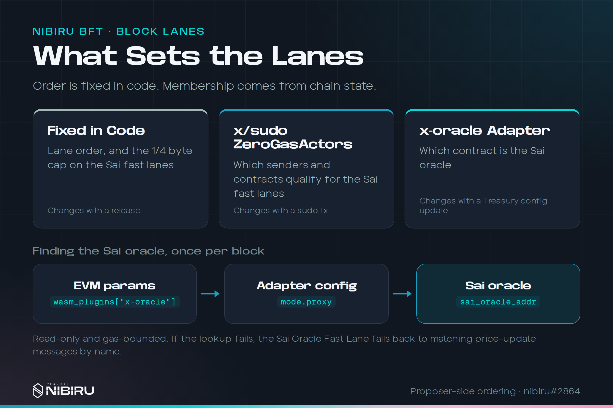
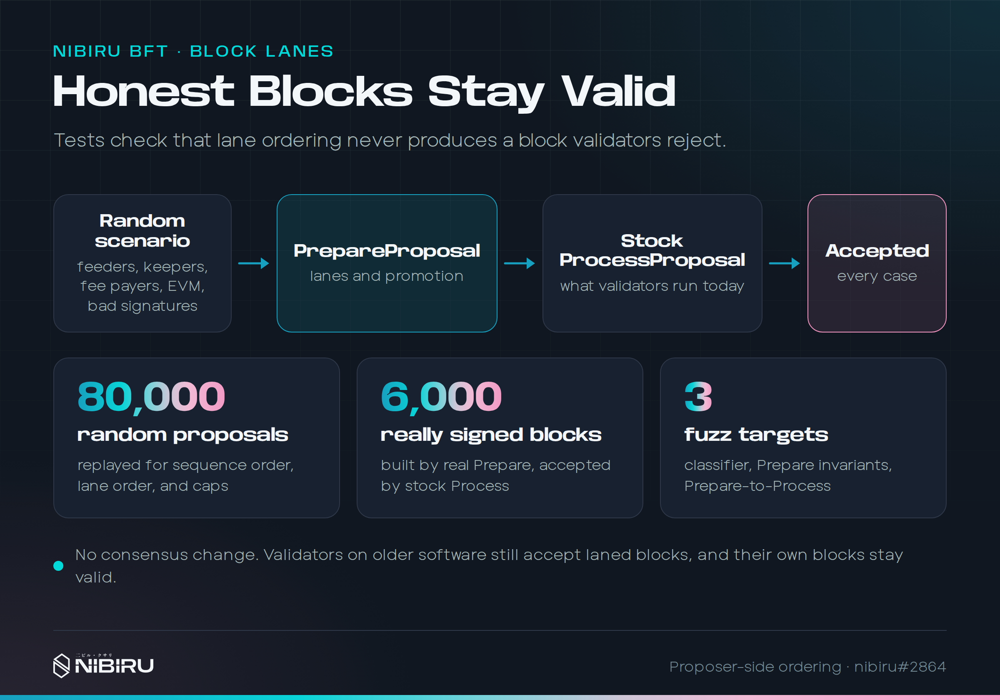

# Nibiru BFT: Block Lanes

{{ $frontmatter.description }}

## TL;DR / Takeaways

1. Nibiru proposes every block in four lanes, in this order: the **Sai Oracle
   Fast Lane**, the **Sai Infra Fast Lane**, the **EVM Lane**, and the
   **Default Lane**.
2. In a block that contains a price write, every later transaction, including
   trades sent through the EVM, executes against that write instead of the
   previous block's price.
3. A transaction's lane comes from its messages, its signers, and an on-chain
   allowlist. Clients add no tags, and no lane has its own gas market.
4. One signer's transactions never get reordered. Earlier transactions move up
   with a later fast-lane transaction instead.
5. The two Sai fast lanes share at most 1/4 of block bytes, so the EVM and
   Default lanes always keep most of the block.
6. This is proposer-side ordering. It needs no coordinated upgrade, and a
   follow-up plans to make oracle-first a consensus rule.

## 1 - Why Order Matters for Financial Apps

Most chains put every pending transaction in one line. Oracle updates,
liquidations, swaps, and token transfers all compete for the same block space,
usually by bidding gas. When the network is busy, fees rise for everyone, and
the transactions that keep markets accurate have to win the same auction as
everything else.

Nibiru took a narrower path than a general fee market redesign. The chain and
its mempool are purpose-built for financial applications such as Sai, a
perpetuals exchange whose prices come from an on-chain oracle. For Sai, the
question that matters most is not who pays the highest fee. It is whether a
trade sees the price that was written in the same block.

### 1.1 - The Ordering Problem

Before block lanes, Nibiru's EVM-aware proposal builder
(`NewEVMPrepareProposalHandler` in `app/prepare_proposal.go`) placed every EVM
transaction first and appended Cosmos transactions after them. Sai oracle price
writes are Cosmos Wasm calls (`MsgExecuteContract`). So any contract call sent
through the EVM in the same block ran before the price write and read the
previous block's price.

Moving all gasless Cosmos transactions ahead of EVM is not enough on its own.
The allowlist that makes Sai's infrastructure calls gasless covers both the
oracle contract and the perps contract. A single fast lane in arrival order
could still run a keeper's trigger-order fill or liquidation before the same
block's price write. The fix needs two fast lanes, with the oracle first.

## 2 - The Four Lanes

<figure>
  
  <figcaption>[Figure] Four lanes, one fixed order. Every transaction in a lane
    runs before every transaction in the next. The two Sai fast lanes share at
    most 1/4 of block bytes.</figcaption>
</figure>

The proposer builds each block in this fixed order:

| # | Lane | What it holds |
| - | ---- | ------------- |
| 1 | **Sai Oracle Fast Lane** | Zero-gas calls to the Sai oracle, with the sender as the only signer: price writes, expiration updates, and admin calls. |
| 2 | **Sai Infra Fast Lane** | Other allowlisted zero-gas Wasm calls, such as keeper fills and liquidations. |
| 3 | **EVM Lane** | Ethereum transactions from the nonce-aware EVM mempool. |
| 4 | **Default Lane** | Every other Cosmos transaction: bank sends, staking, and ordinary Wasm calls. |

A few details hold across lanes:

- The Sai Oracle Fast Lane, Sai Infra Fast Lane, and Default Lane draw from the
  candidates CometBFT hands to `PrepareProposal`. Each keeps CometBFT's
  relative order within the lane.
- The EVM Lane fills from Nibiru's own EVM mempool, not from the CometBFT
  candidates. It selects each sender's unbroken run of nonces, starting at the
  committed state nonce, and interleaves senders by priority, then arrival.
- All four lanes share one byte and gas budget and fill in lane order. A
  transaction that does not fit is skipped and stays in the mempool for a
  later block.

## 3 - How a Transaction Gets Its Lane

<figure>
  
  <figcaption>[Figure] Three checks on a transaction's messages and signers. No
    client tags.</figcaption>
</figure>

The lane classifier (`classifyProposalTx` in `app/proposal_lanes.go`) runs
three checks, in order:

1. **Is it an Ethereum transaction?** If yes, it goes to the EVM Lane.
2. **Is it an allowlisted zero-gas Wasm call?** Every message must be a Wasm
   execute, and the first message's sender and every called contract must
   appear in the x/sudo module's `ZeroGasActors` allowlist. If not, the
   transaction goes to the Default Lane. This is the same predicate
   (`ante.IsZeroGasActorTx`) that exempts the transaction from gas, so
   ordering and gas exemption share one definition.
3. **Does it call the Sai oracle, signed by the sender alone?** Every message
   must execute the Sai oracle contract, and the first message's sender must
   be the transaction's only signer. A separate fee payer counts as a second
   signer. If yes, the transaction goes to the Sai Oracle Fast Lane. If not, it
   goes to the Sai Infra Fast Lane, so an oracle call with a co-signer or a
   separate fee payer lands there too.

The sole-signer rule keeps promotion, described in the next section, tied to
the oracle caller. Without it, any account that co-signed or paid for an oracle
call would have its own earlier transactions pulled ahead of the block's price
writes.

### 3.1 - Finding the Sai Oracle

The proposer reads the Sai oracle address once per block from committed state:

1. The EVM module's params name an `x-oracle` Wasm plugin, which is the
   x-oracle adapter contract.
2. A `{"config":{}}` query to the adapter returns its mode. In proxy mode,
   `mode.proxy.sai_oracle_addr` is the Sai oracle.

The query is read-only and gas-bounded. It runs on a discarded copy of state
under its own gas limit, so it charges no block gas and writes nothing.

If the adapter is missing, is in fixture mode, or the query fails, the Sai
Oracle Fast Lane falls back to matching messages by key. A Wasm message whose
JSON has exactly one top-level key, `set_prices` or `set_price`, counts as an
oracle call. Localnets and test apps without the adapter keep an oracle lane
this way.

## 4 - Promotion: One Signer's Transactions Stay in Order

<figure>
  
  <figcaption>[Figure] Promotion keeps order. A plain sort by lane breaks the
    feeder's sequence. Holding the price update back keeps the block valid but
    runs the swap against the previous price. Promotion keeps both the
    sequence and the price-first order.</figcaption>
</figure>

Cosmos transactions carry an account sequence number, and the ante handler
checks it for every signer, fee payers included. If lanes sorted a signer's
transaction at sequence 8 ahead of the same signer's transaction at
sequence 7, the one at sequence 8 would fail its sequence check and miss the
block.

Nibiru never reorders one signer's transactions. It also never pushes a
fast-lane transaction back to solve this. Instead it **promotes**: an earlier
transaction moves up to the lane of any later transaction it shares a signer
with. The builder walks the candidates from last to first, so promotion
carries through chains of shared signers.

The figure shows the common case. A price feeder sends a transfer at
sequence 7, then a price update at sequence 8. The transfer would normally sit
in the Default Lane. Promotion lifts it into the Sai Oracle Fast Lane, right
ahead of the price update. The feeder's sequence holds, and the price still
leads the block.

Promotion has a few edges worth knowing:

- Promotion follows every shared signer. A co-signer or fee payer of a Sai
  Infra Fast Lane transaction also has its earlier transactions promoted. That
  requires an allowlisted sender to sign a transaction naming that account,
  and Nibiru prefers it to delaying the allowlisted transaction behind the EVM
  Lane.
- Promotion is computed over all candidates before the byte and gas budgets
  pick the final set. If the transaction that justified a promotion is skipped,
  the promoted transaction keeps its earlier spot. The block stays valid,
  because it still precedes its signer's later transactions.
- Promotion does not see the EVM mempool. If one account had an EVM
  transaction at nonce N and a zero-gas Cosmos transaction at N+1, the Cosmos
  transaction would wait a block. Zero-gas keys do not send EVM transactions in
  practice.

## 5 - The Priority Byte Cap

Zero-gas transactions pay no fees, so no fee market limits how much of a block
they take. Nibiru caps them directly: the Sai Oracle Fast Lane and Sai Infra
Fast Lane together may use at most 1/4 of the block's transaction bytes
(`MaxTxBytes`).

- The Sai Oracle Fast Lane fills first. When space under the cap is scarce, a
  price write wins over a keeper fill.
- Candidates over the cap are skipped and stay in the mempool for a later
  block.
- The cap is a ceiling, not a reservation. Any space the fast lanes leave
  unused flows to the EVM Lane and Default Lane.

Price writes are small, so a quarter of the block leaves ample room for every
price write and routine keeper action. The EVM and Default lanes always keep
at least 3/4 of the block, even if an allowlisted key sends far more
transactions than expected.

## 6 - What Sets the Lanes

<figure>
  
  <figcaption>[Figure] Order is fixed in code. Membership comes from chain
    state.</figcaption>
</figure>

| Setting | Where it lives | How it changes |
| ------- | -------------- | -------------- |
| Lane order and the 1/4 byte cap | Code (`app/proposal_lanes.go`, `app/prepare_proposal.go`) | A software release |
| Which senders and contracts qualify for the Sai fast lanes | The x/sudo module's `ZeroGasActors` allowlist | A sudo transaction |
| Which contract is the Sai oracle | The x-oracle adapter's config | An update to the adapter's config |

This split keeps the rules that shape every block in reviewed code. It keeps
operational choices, such as adding a keeper key, in chain state, where they
can change without a release.

## 7 - Status, Rollout, and Limits

<figure>
  
  <figcaption>[Figure] Honest blocks stay valid. Tests run lane-ordered
    proposals through the stock ProcessProposal that validators run today, and
    every block is accepted.</figcaption>
</figure>

Block lanes ship with the Nibiru release that includes
[#2864](https://github.com/NibiruChain/nibiru/pull/2864).

### 7.1 - Proposer-Side Ordering

Only proposal construction (`PrepareProposal`) changes. The stock
`ProcessProposal` that validators use to vote on a block checks each
transaction and the block's total gas, but not transaction order. So:

- Validators can upgrade on their own schedule. No coordinated chain upgrade
  is needed.
- Validators on older software still accept laned blocks, and their own blocks
  stay valid.
- Each block from an upgraded proposer gets the lane order. A block from a
  proposer on older software keeps the old order.

### 7.2 - When the Ordering Applies

Oracle-first ordering takes effect only when all of these hold:

- **The block contains a price write.** The feeder writes on a short interval,
  but not every block contains a write.
- **CometBFT reaped the write.** CometBFT hands candidates to the proposer
  first in, first out, under the block byte limit, and EVM transactions use
  that budget too. Under a backlog larger than a block, the write may be
  missing from the candidates while the EVM Lane still fills from Nibiru's EVM
  mempool.
- **The proposer runs the lane-aware code.** Until enforcement lands, another
  proposer can order its block differently.

Two smaller items remain open:

- **Gas budget.** The fast lanes are charged for each transaction's declared
  gas. On a chain with a finite block gas limit, they could use the gas budget
  before any EVM transaction is considered. A per-lane gas cap is planned for
  the follow-up.
- **Sai Infra Fast Lane membership.** When the Sai intent executor's key is on
  the allowlist, the user trades it relays land in the Sai Infra Fast Lane,
  ahead of trades sent through the EVM. Whether that lane should hold only
  maintenance calls, such as liquidations and trigger fills, is still to be
  decided.

### 7.3 - Toward Consensus Enforcement

A draft follow-up, [#2877](https://github.com/NibiruChain/nibiru/pull/2877),
plans to make oracle-first a consensus rule in `ProcessProposal`, activated
by a chain upgrade. After that upgrade, validators would reject a block in
which a price write comes after a transaction with no reason to precede it.
Promoted transactions would still be allowed ahead of the writes that justify
them.

The draft enforces only what pricing depends on: price writes first, plus the
priority byte cap. It does not enforce the order among the Sai Infra Fast Lane,
EVM Lane, and Default Lane, because every extra rule is another way for an
honest block to be rejected. `PrepareProposal` and `ProcessProposal` would
share one lane function, so the proposer and the voting validators cannot
disagree about where a transaction belongs. The draft is still under review,
and its open questions are listed in the PR.

## 8 - Why Purpose-Built Lanes

General lane frameworks exist. Skip's Block SDK, for example, gives each lane
its own mempool, share of block space, and fee market, and assigns
transactions to lanes through lane-specific matching logic. Nibiru considered
that approach and did not take it. Nibiru classifies by message, signer, and
on-chain allowlist, with no client tags and no per-lane gas markets.

A fixed, purpose-built design fits Nibiru's needs better today:

- **One main customer with an ordering requirement.** Sai's pricing
  correctness depends on order, not on fees. Four fixed lanes express that
  requirement directly.
- **Nothing for clients to get right.** A transaction's lane follows from what
  it does and who signed it. Wallets, dApps, and SDKs need no changes, and no
  client can place a transaction in a lane it does not qualify for.
- **Easier to verify, and later to enforce.** A small classifier with a fixed
  order is simple to cover with property tests and fuzzing, and simple to turn
  into a consensus rule, which is the path #2877 takes.
- **Fees stay where they are.** EVM transactions keep their existing priority
  and nonce handling. Sai's infrastructure calls are already gasless through
  x/sudo, so separate gas markets per lane would add complexity without making
  prices any fresher.

A more general lane registry may make sense later. Two signals would justify
it:

- A second protocol needs its own lane with its own ordering guarantee.
- Lane caps need tuning without a software release, which would mean moving
  them into chain state.

Until then, a few fixed lanes keep each block's order easy to reason about:
oracle prices first, then the infrastructure that depends on them, then
everything else.
