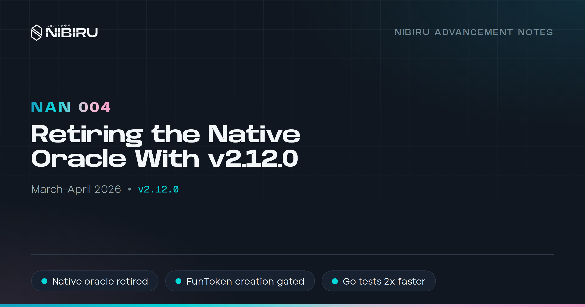
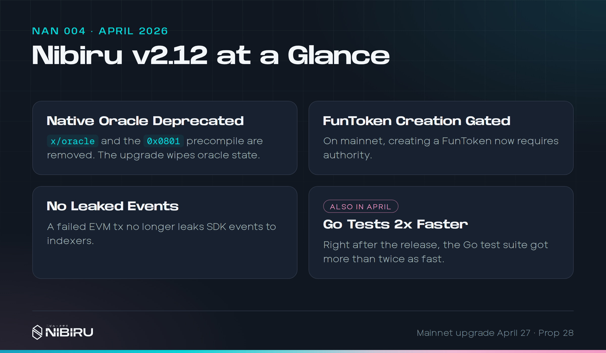
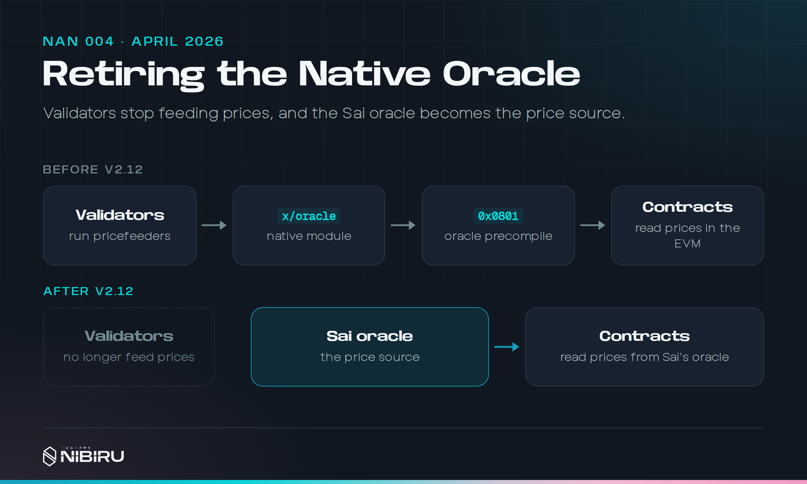

# NAN 004: Retiring the Native Oracle with v2.12.0

*Posted by [Unique](https://uniquedivine.com/web3/nibiru/nibi-inc/) on 2026-04-30*. Release: v2.12.0. Prior mainnet upgrade: v2.11.0.

> *[NAN 003](./nan-003.md) < [Nibiru Advancement Notes (NANs)](./index.md) > [NAN 005](./nan-005.md)*

## Summary

* **Validators are out of the price business.** The chain's built-in oracle
  is retired, so validators no longer vote on prices or get slashed for
  missing a vote. The upgrade clears the oracle's stored data.
* **EVM contracts can no longer read prices from `0x0801`.** The old oracle
  precompile is gone, along with its Solidity interfaces in
  `@nibiruchain/solidity`.
* **Mapping a token between the Cosmos and EVM sides needs approval on
  mainnet.** Creating a FunToken is no longer permissionless there.
* **Indexers stop seeing events from failed EVM transactions.** Work the
  EVM rolled back no longer shows up as Cosmos events.
* **Our Go test suite runs more than twice as fast.**

March had no release. Most of that month went into the work that landed here,
so this note covers both months.

## 1) Why we turned off the native oracle

<!-- Sources:
- https://github.com/NibiruChain/nibiru/pull/2547 (merged 2026-04-27):
  v2.12.0 handler empties the whitelist and clears votes, miss counters,
  prices, snapshots; drops CLI, ABCI hooks, slashing, Wasm queries, 0x0801.
  Code: nibi-chain/app/upgrades/v2_12_0.go.
- Mainnet v2.12.0-p1, h 40,511,000, 2026-04-27, prop 28. p1 stopped the
  handler deleting price snapshots (notes-shipped-chain-2026.md).
- CHANGELOG.md v2.12.0, API Breaking: IOracle, NibiruOracleChainLinkLike*.
- Soft-deprecation reasoning, Apr 24 (#eng-blockchain):
  https://nibiruchain.slack.com/archives/C03DYE815BK/p1777043572727009?thread_ts=1776955405.445839
- Slashing from a faulty feed (Avalon), reimbursed, Feb 9 (#eng-devops):
  https://nibiruchain.slack.com/archives/C03GC05E37S/p1770658661749949?thread_ts=1770653946.370569
- boku epics/26-04-24-nibi-v2-12/26-02-13-spec-oracle-deprecation.md,
  README.md. MIM fallout: epics/26-06-24-mim-oft/README.md.
-->

Nibiru launched with an oracle built into the chain. Validators ran a
pricefeeder alongside their node, voted on exchange rates each period, and got
slashed if they missed too many votes. Contracts read the result through the
`x/oracle` module or, on the EVM side, through a precompile at `0x0801`.

On paper, that's the decentralized way to do prices. In practice, most of
the benefit never showed up. Every validator ran the same pricefeeder
software, so many voters running one program added little over a single good
feed. The costs, meanwhile, were real:

* **Validators could be slashed for running the correct software.** When a
  market moved fast, honest votes could land outside the module's tolerance
  for deviation, and the validator got penalized anyway. This happened more
  than once.
* **Changes were slow.** Adding a market or changing how a price was
  computed meant a chain upgrade.
* **It was code we had to maintain** in the most sensitive part of the
  chain, for prices our main product didn't read.

Sai already ran its own oracle as a smart contract, and it was better on
every axis we cared about. It covers stocks, ETFs, commodities, and far more
crypto assets than the native oracle ever did. It updates more often. We can
change it with a contract migration instead of a network upgrade, and we
iterated on it quickly all year.

So the question wasn't whether the native oracle was decentralized. It was
whether keeping it made Nibiru more likely to win. We'd written that code,
but having written it isn't a reason to keep it. It was tech debt, and
removing it meant less code, fewer places for bugs, and no validator slashed
for doing its job.

v2.12.0 makes the module inert ([PR #2547](https://github.com/NibiruChain/nibiru/pull/2547)):

* Oracle transactions return a deprecation error right away.
* The upgrade handler clears the whitelist, votes, miss counters, prices, and
  snapshots, so nothing stale stays queryable.
* The upgrade removes slashing, the end-block hooks, the CLI, the Wasm query
  route, and the EVM precompile.
* Query routes stay registered. They return empty results, so callers that
  expect the endpoint to exist don't break.

We left the module in place, inert, on purpose. This is a soft deprecation.
Deleting the module outright changes the store layout, and we didn't want to
risk a mainnet outage for no clear gain. An inert module adds little to the
binary. It gets validators out of the price business now and keeps the
upgrade simple.

We'd still like to remove the module completely someday, and to learn how to
delete a module's state safely along the way. Until that's clearly safe, soft
deprecation is the pragmatic choice.

### What we got wrong

Removing the precompile broke a caller we didn't account for. MIM's OFT
bridge quoted its fees through `0x0801`, and those quotes started reverting.
We brought back a narrow version of the precompile two months later, backed
by Sai's oracle instead of the old module. [NAN 005](./nan-005.md) tells that
part.

The lesson I'd take from it: before removing a contract-facing address, find
every deployed contract that calls it, not only the ones you maintain.

## 2) FunToken creation needs authority on mainnet

<!-- Sources:
- https://github.com/NibiruChain/nibiru/pull/2548 (merged 2026-04-27):
  mainnet CreateFunToken needs gov authority or sudo; the check runs before
  the creation fee is deducted; non-mainnet unchanged.
  Code: nibi-chain/evm/evmstate/msg_server.go CreateFunToken.
- "Hardens how precompiles authorize calls": keep to this one line. No PR
  or detail (security-sensitive list in notes-shipped-chain-2026.md).
-->

A FunToken maps a Bank coin to an ERC20 contract so the same asset moves
between Nibiru's Cosmos and EVM sides. Until v2.12, anyone could create one on
mainnet. Now it takes governance or the chain's sudo admin
([PR #2548](https://github.com/NibiruChain/nibiru/pull/2548)).

Testnet and local networks keep permissionless creation, so builders can
still experiment there. On mainnet, someone reviews a mapping before it
becomes canonical.

The release also hardens how precompiles authorize calls.

## 3) Failed EVM transactions stop leaking events

<!-- Sources:
- https://github.com/NibiruChain/nibiru/pull/2543 (merged 2026-03-07),
  closes https://github.com/NibiruChain/nibiru/issues/2542. Shipped in
  v2.12.0 (CHANGELOG.md v2.12.0, Improvements).
  Code: nibi-chain/evm/evmstate/msg_server.go
  MaybeTruncateEventsForFailedEvmTx; evm/const.go GetEvmEventTruncationMark.
- v2.17 follow-up: https://github.com/NibiruChain/nibiru/pull/2696
  (merged 2026-07-14), closes nibiru#2096.
- Two fixes in this area: #2543 and #2696. No middle fix exists.
-->

When an EVM transaction fails, the EVM rolls back its state. Nibiru's Cosmos
side could still emit events from work done during that transaction, such as
a Bank transfer. An indexer reading those events would record a transfer that
never happened.

v2.12 truncates those leaked events while keeping the EVM's own failure
record intact ([PR #2543](https://github.com/NibiruChain/nibiru/pull/2543)).
It was the first of two fixes in this area. v2.17 went further and rolls
events back with every EVM snapshot. [NAN 006](./nan-006.md) covers that.

## 4) Faster tests

<!-- Sources:
- https://github.com/NibiruChain/nibiru/pull/2550 (merged 2026-04-28):
  `just test` wall time 37 s; CI suite "used to take about 13 minutes".
  Closes nibiru#1918, #2427.
- https://github.com/NibiruChain/nibiru/pull/2560 (merged 2026-04-28):
  dropped -covermode=atomic; 371.80 s -> 165.56 s, about 2.25x.
- nibiru#2559 (2026-04-28, closes #2454), nibiru#2562 (2026-04-28,
  closes #2452): test determinism.
- https://github.com/NibiruChain/nibiru/pull/2549 (merged 2026-04-27).
- boku epics/26-04-24-nibi-v2-12/pr-4-key-list.md, pr-6-testnetwork.md
-->

After the release we spent a few days on the test suite. Integration tests
now run against a persistent localnet instead of starting a chain per test
([PR #2550](https://github.com/NibiruChain/nibiru/pull/2550)). A change to
the coverage mode cut Go test time by more than half
([PR #2560](https://github.com/NibiruChain/nibiru/pull/2560)). Two more
fixes removed sources of flaky results
([PR #2559](https://github.com/NibiruChain/nibiru/pull/2559),
[PR #2562](https://github.com/NibiruChain/nibiru/pull/2562)).

Users never see this, but it sets how fast we can ship everything else.

One small CLI change for builders: `nibid keys list` now shows EVM addresses
too ([PR #2549](https://github.com/NibiruChain/nibiru/pull/2549)).

## 5) On Sai: stocks, ETFs, and commodities

<!-- Sources (notes-shipped-sai-2026.md, April; sai-web is private, no links):
- Release PRs sai-web#834 (04-22), #859 (04-28). 21 of 25 symbols live;
  BRK.B, XPT, XPD, WTI did not open on mainnet.
- sai-web#627 PWA, #791 and #830 price impact, #833 positions on chart,
  #836 starred markets and open positions.
- Stock price stall fallback, sai-keeper#325, Apr 9 (#eng-perp):
  https://nibiruchain.slack.com/archives/C07LAL4Q5BR/p1775746047992959
- boku epics/26-03-25-sai-new-markets/, 26-03-30-sai-price-impact-viz/
- Combined price event is `set_prices` in sai-perps
  contracts/oracle/src/events.rs event_set_prices. It dates from
  sai-perps#255 (2025-11-19), so it predates April.
-->

April was Sai's biggest listing month. 21 of the 25 symbols we scoped went
live across stocks, ETFs, and commodities. We wrote about the launch in
[Sai Launches Stock Trading on Perps](https://sai.fun/blog/06-stock-perps-launch).

The app picked up a few things to go with it:

* Starred markets, with your open positions pinned at the top of the market
  list.
* A price-impact chart for each market, so you see the cost before you trade.
* Your positions drawn on the TradingView chart.
* Install Sai as a desktop app through PWA support.

All of these markets run on Sai's oracle contract, the same one that
replaced the native oracle above. Since late 2025, the contract has emitted
one combined event for each batch of prices it receives, so indexers can read
a whole update in a single pass.

## What's next

The oracle removal left loose ends. Some docs and tooling still referred to
pricefeeders, and one bridge still needed `0x0801`. We spent May rehearsing
the fixes on testnet, and v2.14 and v2.15 shipped them in June.

## References

Pull requests behind each section. The Sai repositories are private, so the
text above describes each change on its own.

**1) Why we turned off the native oracle**

* [nibiru#2547](https://github.com/NibiruChain/nibiru/pull/2547): Retire
  the native oracle in the v2.12 upgrade.

**2) FunToken creation needs authority on mainnet**

* [nibiru#2548](https://github.com/NibiruChain/nibiru/pull/2548): Mainnet
  FunToken creation needs governance or sudo.

**3) Failed EVM transactions stop leaking events**

* [nibiru#2543](https://github.com/NibiruChain/nibiru/pull/2543): Truncate
  events from failed EVM transactions.

**4) Faster tests**

* [nibiru#2550](https://github.com/NibiruChain/nibiru/pull/2550) and
  [nibiru#2560](https://github.com/NibiruChain/nibiru/pull/2560): Faster
  local and CI test runs.
* [nibiru#2549](https://github.com/NibiruChain/nibiru/pull/2549): EVM
  addresses in `nibid keys list`.
* [nibiru#2559](https://github.com/NibiruChain/nibiru/pull/2559) and
  [nibiru#2562](https://github.com/NibiruChain/nibiru/pull/2562):
  Deterministic tests.

**5) On Sai: stocks, ETFs, and commodities**

* [sai-web#834](https://github.com/NibiruChain/sai-web/pull/834) and
  [sai-web#859](https://github.com/NibiruChain/sai-web/pull/859): The April
  releases with the new markets.
* [sai-web#791](https://github.com/NibiruChain/sai-web/pull/791) and
  [sai-web#830](https://github.com/NibiruChain/sai-web/pull/830): Price
  impact charts.
* [sai-web#833](https://github.com/NibiruChain/sai-web/pull/833): Your
  positions on the chart.
* [sai-web#836](https://github.com/NibiruChain/sai-web/pull/836): Starred
  markets and open positions in the market list.
* [sai-web#627](https://github.com/NibiruChain/sai-web/pull/627): Install
  Sai as a desktop app.
* [sai-perps#255](https://github.com/NibiruChain/sai-perps/pull/255): One
  combined event per price batch.
* [sai-keeper#325](https://github.com/NibiruChain/sai-keeper/pull/325):
  Force-pull stock prices when the stream goes quiet.
