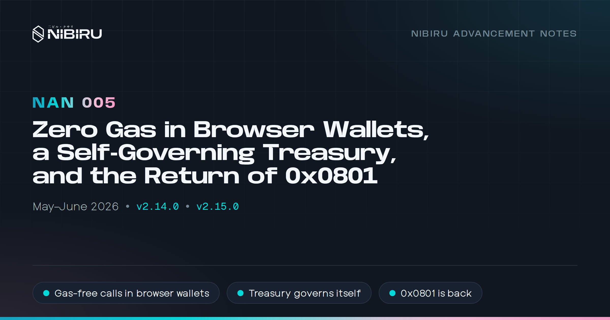
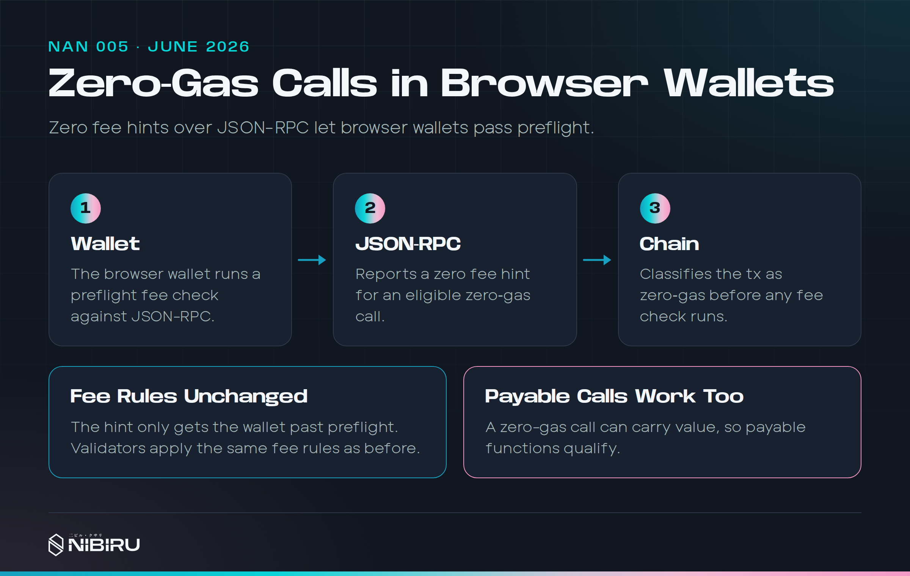
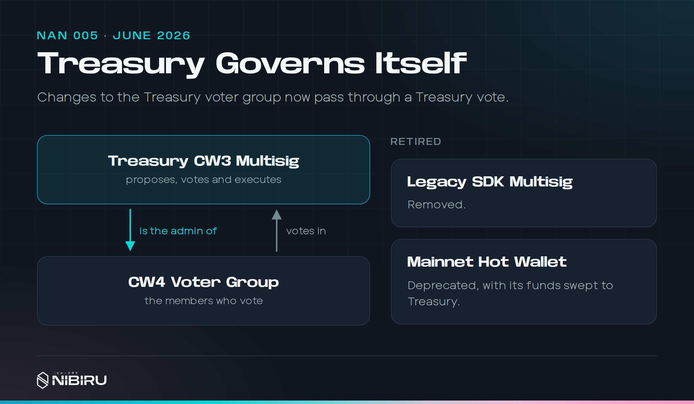
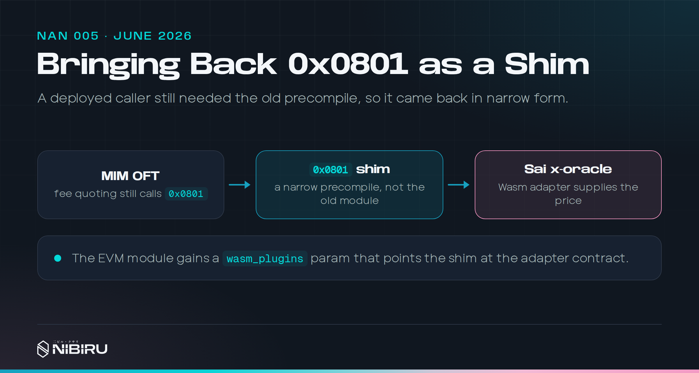

# NAN 005: Zero Gas in Browser Wallets, a Self-Governing Treasury, and the Return of 0x0801

*Posted by [Unique](https://uniquedivine.com/web3/nibiru/nibi-inc/) on 2026-06-30*. Releases: v2.14.0, v2.15.0. Prior mainnet upgrade: v2.12.0.

> *[NAN 004](./nan-004.md) < [Nibiru Advancement Notes (NANs)](./index.md) > [NAN 006](./nan-006.md)*

## Summary

* **Gasless calls work from ordinary browser wallets.** Wallets used to
  block them by filling in fees the account couldn't pay. Gasless calls can
  now send NIBI along, too.
* **The Foundation Treasury manages its own signers.** Adding or removing a
  voter is now a Treasury proposal. We retired the legacy SDK multisig and
  the old Hot Wallet.
* **Fewer ways to touch module-held funds.** Governance deposits and
  tokenfactory got stricter around module accounts.
* **The old oracle address `0x0801` is back**, read-only and backed by Sai's
  oracle, so MIM OFT bridge fee quotes work again.
* **We published our first Wasm runtime fork**, which fixes an ARM64 crash
  that blocked large Sai contracts.
* **`nibid localnet --script`** starts a local chain from the installed
  binary.

May had no mainnet release. We used it to rehearse two v2.14 changes on
testnet, the zero-fee hints and the Treasury migration, with throwaway
`v2.13.0-test.N` tags. That habit stuck. Most releases since have had the
same testnet rehearsal.

## 1) Zero gas has to survive the wallet

<!-- Sources:
- https://github.com/NibiruChain/nibiru/pull/2596 (merged 2026-06-03):
  classify eligible zero-gas EVM txs before fee checks.
- https://github.com/NibiruChain/nibiru/pull/2601 (merged 2026-06-03):
  zero eth_gasPrice, baseFeePerGas, eth_feeHistory rewards, newHeads,
  receipt gasPrice; ante, execution, and BASEFEE keep the real fee.
  Fixes sai-web#948 (confirmed on testnet). Code: nibi-chain/evm/const.go
  WalletZeroBaseFeeWei.
- https://github.com/NibiruChain/nibiru/pull/2610 (merged 2026-06-06).
- Rabby preflight HAR analysis, Jun 1 (#eng-blockchain):
  https://nibiruchain.slack.com/archives/C03DYE815BK/p1780341908345679?thread_ts=1780341908345679
- CHANGELOG.md v2.14.0 sections 4 and 5. Mainnet v2.14.0, prop 29.
- boku epics/26-05-27-sai-evm-fee-exempt-calls.md,
  26-06-05-zero-gas-value-layerzero.md
-->

[NAN 003](./nan-003.md) introduced `always_zero_gas_contracts`, a governance
allowlist of contracts anyone can call without paying NIBI for gas. That
should have solved onboarding. Browser wallets got in the way.

A wallet doesn't know about Nibiru's allowlist. Before it sends anything, it
asks the RPC for gas prices and fee history, fills in the fee fields, and
checks that the account can pay. A brand-new account with no NIBI fails that
check, and the wallet refuses to send a transaction the chain would have
accepted.

v2.14 fixes this from two sides:

* **The chain checks eligibility first.** It recognizes an eligible
  zero-gas call before fee validation, so nonzero fee fields from a wallet
  don't disqualify it ([PR #2596](https://github.com/NibiruChain/nibiru/pull/2596)).
* **The RPC tells wallets what they need to hear.** For zero-gas flows,
  JSON-RPC reports zero across gas price, EIP-1559 fields, fee history,
  WebSocket heads, transactions, and receipts ([PR #2601](https://github.com/NibiruChain/nibiru/pull/2601)).

The second part is a real tradeoff. To get wallets to behave, the fee data
the RPC reports now depends on the call being made, not only on network
conditions. The parts that matter stay honest. Consensus fee rules and EVM
execution don't change for any transaction outside the allowlist.

Why not wait for wallets to support zero gas? Because every wallet talks to
the RPC its own way. Some run their own simulations. Some force a minimum gas
price, probably to give users sensible defaults. The result was that many
wallets charged for a call that cost nothing, the opposite of the onboarding
we wanted. A chain-level fix is wallet-agnostic. It behaves the same in every
wallet and every tool, including ones we've never tested.

The same release, through [PR #2610](https://github.com/NibiruChain/nibiru/pull/2610),
dropped the rule that zero-gas calls must carry no value. A payable call to an
allowlisted contract can now send NIBI with it. The sender still needs enough
balance to cover the amount sent. They just don't pay gas on top of it.

## 2) A Treasury that governs itself

<!-- Sources:
- https://github.com/NibiruChain/nibiru/pull/2602 (merged 2026-06-02):
  handler runs update_members as nibimultisig, makes Treasury CW3 the CW4
  admin, moves Wasm admin of both to Treasury; mainnet Hot Wallet sweep.
  Threshold stays 3-of-N. Code: nibi-chain/app/upgrades/v2_14_0.go
  runUpgrade2_14_0.
- CHANGELOG.md v2.14.0 section 2. Rehearsed as v2.13.0-test.1 to 4
  (05-29 to 06-02) on testnet (notes-shipped-chain-2026.md).
- boku epics/26-05-30-rm-legacy-msig.md, 26-02-06-cw3-msig.md, msig-ops/
-->

The Nibiru Foundation Treasury is a CW3 multisig contract. Its voters live in
a separate CW4 group contract. Until v2.14, the admin of that group was an
older keyring multisig, `nibimultisig`. Its signers were chosen when Nibiru
launched, and more than half of them no longer work on the project. Getting
enough of them to sign anything was close to impossible.

The v2.14 upgrade handler cut that dependency ([PR #2602](https://github.com/NibiruChain/nibiru/pull/2602)):

* It updated the voter set once, removing signers who had left.
* It made the Treasury CW3 contract the admin of its own CW4 voter group.
  Voter changes are now ordinary Treasury proposals.
* It moved Wasm admin rights for both contracts to Treasury.
* On mainnet, it retired the dormant Hot Wallet, swept its balance into
  Treasury, and left its contracts on chain unused.

The threshold stays at 3-of-N. The point was to stop depending on people who
had moved on, without lowering the bar for anyone else.

We did this in an upgrade handler rather than one last `nibimultisig`
transaction, because that transaction would have needed the very signers
who were gone. A chain upgrade runs on validator consensus, not on any one
key. That makes it the right tool for getting around a key nobody can use. The Treasury is now run by the people actively building
Nibiru and Sai.

## 3) Safer deposits and module accounts

<!-- Sources:
- https://github.com/NibiruChain/nibiru/pull/2603 (merged 2026-06-02).
- CHANGELOG.md v2.14.0 section 3.
- boku epics/26-06-02-tokenfactory-gov-deposit-halt.md. Keep public copy
  high level; no reproduction steps.
-->

Module accounts are addresses that chain modules use to hold funds, such as
governance deposits in escrow. v2.14 tightens two modules around them
([PR #2603](https://github.com/NibiruChain/nibiru/pull/2603)):

* Governance deposits only accept the denominations set in `MinDeposit`.
* Tokenfactory, the module that lets accounts create their own coins, can no
  longer mint to or burn from module accounts. Creating a tokenfactory denom
  now takes governance or a sudoer.

These changes close paths that could have touched escrowed funds or module
balances in ways nobody intended.

## 4) Bringing back 0x0801, narrowly

<!-- Sources:
- https://github.com/NibiruChain/nibiru/pull/2621 (merged 2026-06-25):
  queryExchangeRate and chainLinkLatestRoundData, 18-decimal answers,
  answeredInRound = 420; new EVM param wasm_plugins; v2.15.0 handler sets
  the x-oracle address. Code: nibi-chain/evm/precompile/oracle.go
  chainLinkLatestRoundData; app/upgrades/v2_15_0.go.
- Epic: https://github.com/NibiruChain/nibiru/issues/2593
- MIM fee adapter diagnosis, Jun 24 (#eng-blockchain):
  https://nibiruchain.slack.com/archives/C03DYE815BK/p1782338358592089?thread_ts=1781975506.088439
- v2.15.0 release post, Jun 26 (#eng-perp):
  https://nibiruchain.slack.com/archives/C07LAL4Q5BR/p1782482318857409?thread_ts=1782482318.857409
- CHANGELOG.md v2.15.0 sections 2 and 3. Mainnet v2.15.0, prop 30.
- boku epics/26-06-24-mim-oft/README.md, sai-oracle-precompile-compat.md
-->

[NAN 004](./nan-004.md) described turning off the native oracle and removing
its EVM precompile. One deployed contract still needed it. MIM's OFT fee
handler calls `chainLinkLatestRoundData("unibi:uusd")` on `0x0801` to quote
bridge fees, and every quote reverted after v2.12.

We didn't bring back the oracle module. Sai's oracle already prices those
assets, and it updates faster than the native oracle did. v2.15 answers the
old calls from Sai's oracle instead ([PR #2621](https://github.com/NibiruChain/nibiru/pull/2621)):

* `0x0801` exists again and answers the two read methods legacy callers use,
  in the old 18-decimal format.
* Prices come from an `x-oracle` Wasm adapter backed by Sai's oracle. A new
  EVM param, `wasm_plugins`, says which contract that is.
* Native oracle voting, feeders, slashing, and messages stay off.
* It serves the legacy pairs Sai's oracle can keep up: BTC, ETH, ATOM, NIBI,
  and USDC against USD. Other pairs fail clearly. Nothing falls back to
  stale module state.

We kept the list to pairs worth maintaining. Every feed is something to run
and monitor, and on the old oracle every feed was also a way for validators
to get slashed. The shim exists for contracts already deployed. New
contracts should read Sai's oracle directly.

## 5) Our first Wasm runtime fork

<!-- Sources:
- https://github.com/NibiruChain/nibiru/pull/2618 (merged 2026-06-24),
  closes https://github.com/NibiruChain/nibiru/issues/2617: wasmvm v1.5.9
  replaced by NibiruChain/go-wasmvm v1.10.0; libwasmvm assets pulled from
  https://github.com/NibiruChain/go-wasmvm.
- CHANGELOG.md v2.15.0 section 4.
- boku epics/26-02-sai-wasmer-panic.md,
  26-06-22-nibi-wasm-vendored-wasmer-trim.md
-->

ARM64 nodes crashed when they stored or instantiated large Sai contracts.
The fault was a relocation bug in Wasmer's Singlepass compiler. We published our
own `go-wasmvm v1.10.0` with the fix, including the macOS build ([PR #2618](https://github.com/NibiruChain/nibiru/pull/2618)).

It looked like a one-off at the time. In hindsight, it was the first step
toward owning the Wasm runtime, which [NAN 006](./nan-006.md) and
[NAN 008](./nan-008.md) pick up.

## 6) On Sai

<!-- Sources (notes-shipped-sai-2026.md, June; sai-web is private, no links):
- Releases sai-web#967 (06-05), #979 (06-15), #991 (06-24), #997 (06-26).
- sai.fun and market pages: sai-web#995, #996 (06-26).
- TP/SL drag on chart: sai-web#841 (changelog v1.15.0, 06-01).
- Chart buy/sell markers: sai-web#964 (06-27). Fee details: #977.
- Grand Cup: sai-web#987 (06-24); region guard #994.
-->

* **Sai moved to sai.fun**, and every market got its own page.
* **TP/SL on the chart.** Drag your take profit and stop loss lines to edit
  them.
* **Your trades on the chart.** Buy and sell markers from your trade history.
* **Fee details** on every row of your trade history.
* **The Sai Grand Cup**, our continent-vs-continent competition
  ([announcement](https://sai.fun/blog/08-sai-grand-cup)).

## References

Pull requests behind each section. The Sai repositories are private, so the
text above describes each change on its own.

**1) Zero gas has to survive the wallet**

* [nibiru#2596](https://github.com/NibiruChain/nibiru/pull/2596): Classify
  zero-gas calls before fee checks.
* [nibiru#2601](https://github.com/NibiruChain/nibiru/pull/2601): Report
  zero fees to wallets for zero-gas flows.
* [nibiru#2610](https://github.com/NibiruChain/nibiru/pull/2610): Zero-gas
  calls can carry value.

**2) A Treasury that governs itself**

* [nibiru#2602](https://github.com/NibiruChain/nibiru/pull/2602): The v2.14
  Treasury migration.

**3) Safer deposits and module accounts**

* [nibiru#2603](https://github.com/NibiruChain/nibiru/pull/2603): Deposit
  denominations and tokenfactory limits.

**4) Bringing back 0x0801, narrowly**

* [nibiru#2621](https://github.com/NibiruChain/nibiru/pull/2621): The
  `0x0801` shim backed by Sai's oracle.

**5) Our first Wasm runtime fork**

* [nibiru#2618](https://github.com/NibiruChain/nibiru/pull/2618): Nibiru's
  `go-wasmvm v1.10.0` with the ARM64 fix.

**6) On Sai**

* [sai-web#995](https://github.com/NibiruChain/sai-web/pull/995) and
  [sai-web#996](https://github.com/NibiruChain/sai-web/pull/996): Market
  pages and the move to sai.fun.
* [sai-web#841](https://github.com/NibiruChain/sai-web/pull/841): TP/SL on
  the chart.
* [sai-web#964](https://github.com/NibiruChain/sai-web/pull/964): Buy and
  sell markers on the chart.
* [sai-web#977](https://github.com/NibiruChain/sai-web/pull/977): Fee
  details in trade history.
* [sai-web#987](https://github.com/NibiruChain/sai-web/pull/987): The Sai
  Grand Cup.
