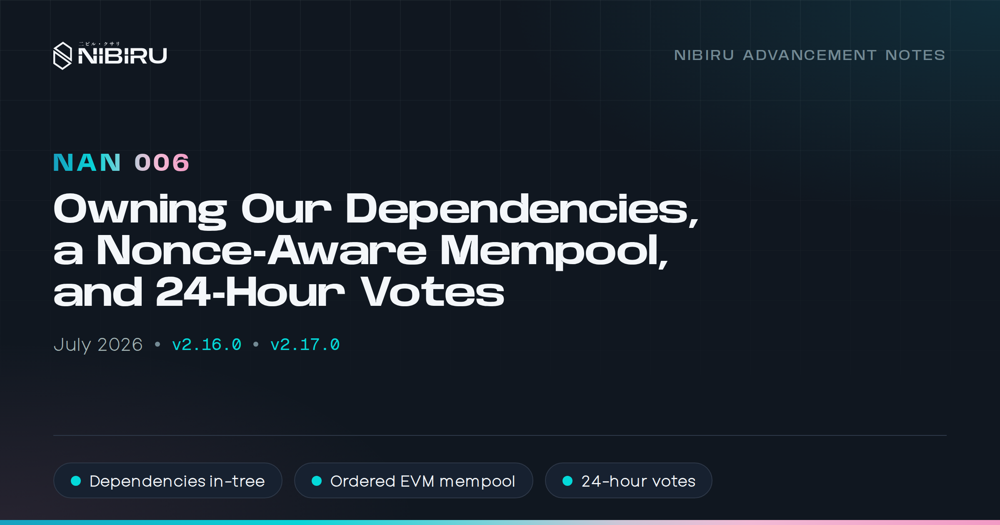
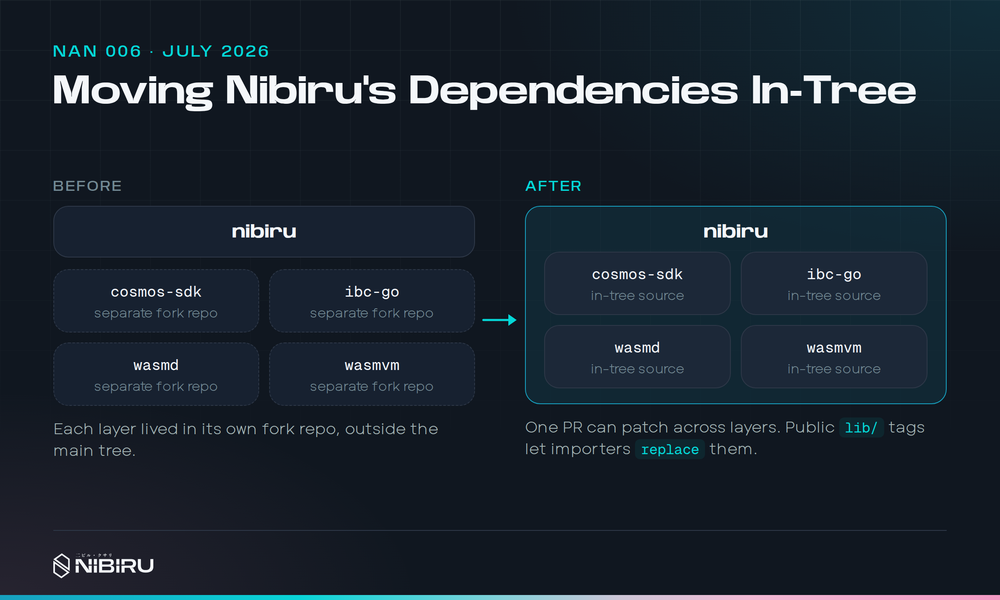
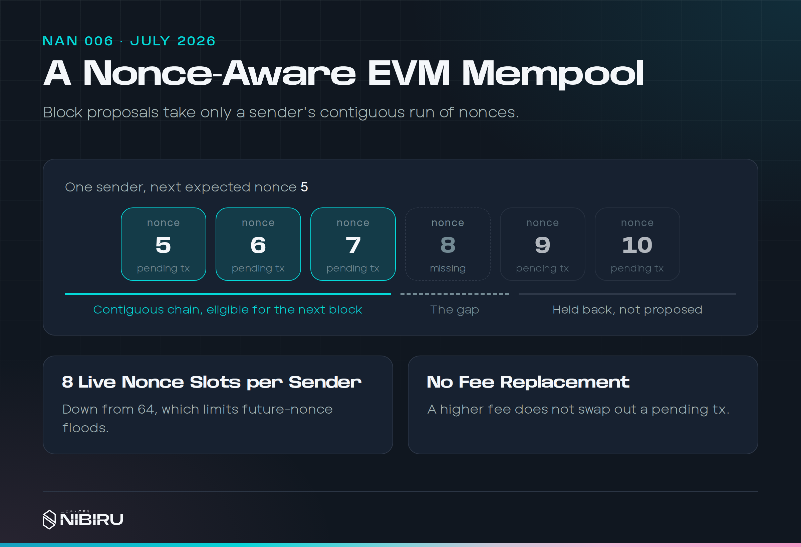

# NAN 006: Owning Our Dependencies, a Nonce-Aware Mempool, and 24-Hour Votes

*Posted by [Unique](https://uniquedivine.com/web3/nibiru/nibi-inc/) on 2026-07-31*. Releases: v2.16.0, v2.17.0. Prior mainnet upgrade: v2.15.0.

> *[NAN 005](./nan-005.md) < [Nibiru Advancement Notes (NANs)](./index.md) > [NAN 007](./nan-007.md)*

<!-- Verified 2026-10-29: `nibid q upgrade applied v2.17.0` on mainnet
reports height 43,464,589. -->

## Summary

* **Our dependencies live in our repository.** The Cosmos SDK, IBC Go,
  `x/wasm`, and the Wasm VM are first-party source under `lib/` and `x/wasm`,
  so one PR can fix a bug that spans them.
* **One sender can't flood blocks with EVM transactions that can never
  execute.** The mempool now tracks each sender's nonces.
* **Mainnet governance votes take 24 hours** instead of 48.
* **Authz is off.** No account can grant another account permission to act
  for it. Grants can't be created, executed, or revoked.
* **Chain maintenance can run every block without a bot.** Wasm block hooks
  let a governed registry contract schedule privileged calls at the start
  and end of each block.
* **Events roll back with the EVM.** A reverted EVM call takes its Cosmos
  events with it.
* **Balance queries understand both VMs.** One query returns a token's Bank
  and ERC20 balances.

## 1) Why we stopped consuming forks

<!-- Sources:
- https://github.com/NibiruChain/nibiru/pull/2646 (merged 2026-07-03):
  public tags lib/cosmos-sdk/v0.47.14-nibiru, lib/wasmd/v0.44.1-nibiru.
- https://github.com/NibiruChain/nibiru/pull/2656 (merged 2026-07-06);
  lib/wasmvm v1.12.0 tag 07-13.
- https://github.com/NibiruChain/nibiru/pull/2686 (merged 2026-07-11),
  ibc-go vendored, ICS-29 removed.
- https://github.com/NibiruChain/nibiru/pull/2690 (merged 2026-07-13):
  2,527 changed files; also renames x/inflation to x/mint.
- https://github.com/NibiruChain/nibiru/pull/2713 (merged 2026-07-23).
- depinject removal #2637 to #2643. CHANGELOG.md v2.17.0 section 7.
- boku epics/26-08-26-nibi-chain/26-07-05-nibiru-lib-monorepo.md,
  26-07-03-nibi-chain-lib-modules.md, 05-module-ownership-and-wasm.md.
  October BFT: epics/26-10-18-sai-node-perf/08-nibiru-bft-fork.md
-->

Nibiru had been running patched versions of the Cosmos SDK, wasmd, and the
Wasm VM for a long time. Each lived in its own fork and repository. A fix that
touched two layers, say the SDK and the EVM module, meant coordinated PRs
across repositories, version bumps, and `replace` directives that drifted.

In July we moved all of it into the chain repository:

* The Cosmos SDK and wasmd forks moved to `lib/`, with public module tags
  `lib/cosmos-sdk/v0.47.14-nibiru` and `lib/wasmd/v0.44.1-nibiru` so other Go
  projects can import them ([PR #2646](https://github.com/NibiruChain/nibiru/pull/2646)).
* `x/wasm` became first-party chain code, and the Wasm VM's Go bindings
  moved to `lib/wasmvm-ffi` with their own CI and release tags
  ([PR #2656](https://github.com/NibiruChain/nibiru/pull/2656)).
* IBC Go v7 moved to `lib/ibc-go`. We removed the ICS-29 fee middleware at
  the same time, since it was never active on mainnet ([PR #2686](https://github.com/NibiruChain/nibiru/pull/2686)).
* The SDK and IBC Go were flattened into the root module, and protobuf
  generation now resolves them locally ([PR #2690](https://github.com/NibiruChain/nibiru/pull/2690)).

The cost was real. The flatten alone touched about 2,500 files, mostly
import rewrites and regenerated protobuf code. The move also broke the
version flags in release builds, which left `nibid version` empty until
[PR #2713](https://github.com/NibiruChain/nibiru/pull/2713) fixed it. CI now
fails if a build has empty version fields, or if anything imports the
upstream modules again.

Why one repository? Because these pieces were never really separate. The
chain, the SDK fork, wasmd, and the Wasm VM change together. Keeping them in
separate repositories hid that coupling instead of removing it. A patch in
one place quietly changed a dependency somewhere else, and Go `replace`
statements piled up to hold it all together. Google and Meta keep coupled
code in one repository for the same reason, at far larger scale.

The payoff is that one PR can now fix a bug across the SDK, the EVM, and Wasm,
and one test run covers all three. There are far fewer `replace` statements.
Refactors and bug fixes are faster, and so is the loop from a change to a
built binary to a passing end-to-end test. In October we did the same thing
for the consensus engine.

<!-- Interview, 26-11-03: monorepo reasoning is coupling, replace-statement
sprawl, and faster refactor/fix/release loops. No single triggering bug. -->

## 2) A mempool that understands nonces

<!-- Sources:
- https://github.com/NibiruChain/nibiru/pull/2702 (merged 2026-07-22).
  Body still says 64 slots. 64 -> 8 is commit f9c927232 (2026-07-22),
  pushed to main after #2702 without its own PR.
  Code: nibi-chain/evm/mempool.go NewMempool;
  evm/evmante/evmante_increment_sender_seq.go MaxPendingTxsPerSender = 8;
  app/prepare_proposal.go NewEVMPrepareProposalHandler.
- Testnet-2 future-nonce spam, Jul 22 (#eng-devops):
  https://nibiruchain.slack.com/archives/C03GC05E37S/p1784717160667589?thread_ts=1784647355.715949
- Unique on SDK mempool design, same thread:
  https://nibiruchain.slack.com/archives/C03GC05E37S/p1784724427144479?thread_ts=1784647355.715949
- boku epics/26-07-13-abci-baseapp/02-evm-nonce-flood-solutions.md
- CHANGELOG.md v2.17.0 section 2. Mainnet v2.17.0 h 43,464,589.
-->

An EVM account's transactions run in nonce order. If nonce 11 is missing,
nonce 12 can't run, however long it waits.

Before v2.17, a sender could submit a pile of transactions with future
nonces. The node accepted anything within its future window and gossiped it
to peers. Proposers could then pack blocks with transactions that had no
chance of executing.

v2.17 adds an EVM-aware mempool ([PR #2702](https://github.com/NibiruChain/nibiru/pull/2702)):

* It indexes transactions by sender and nonce.
* Each sender gets at most 8 live nonce slots. A different transaction for a
  slot that's already taken is rejected.
* Block proposals only include each sender's contiguous chain starting from
  the committed nonce. Gaps stay out.
* After each block, recheck drops any transaction whose earlier nonces are
  missing.

Two choices are worth calling out. The PR first allowed 64 slots per sender,
and we lowered it to 8 before release. We were dealing with heavy bursts of
spam at the time, and real accounts rarely need many pending transactions.
Most send two or three in a row, sometimes five, and we've almost never seen
one need more than ten. A tight limit costs real users nothing and makes
spamming the nodes harder. If usage grows into it, we can raise it.

The second choice is that there's no fee-based replacement. You can't
resubmit the same nonce with a higher fee to jump ahead. That keeps the
mempool simple, at the cost of a feature some wallets expect.

<!-- Interview, 26-11-03: 8 is deliberately aggressive (YAGNI). Typical
accounts use 2 to 5 pending txs, almost never over 10. Spam context in
epics/26-07-13-abci-baseapp/02-evm-nonce-flood-solutions.md. -->

None of this needed a CometBFT fork or a consensus migration. The index is
local to each node and only shapes which transactions get proposed. Block
validation still requires exact nonces.

## 3) Faster governance

<!-- Sources:
- https://github.com/NibiruChain/nibiru/pull/2632 (merged 2026-07-02):
  mainnet-only gov param change in the v2.16.0 handler, non-halting on
  failure. Code: nibi-chain/app/upgrades/v2.go Handler_v2_16.
- CHANGELOG.md v2.16.0 section 4. Mainnet v2.16.0 h 42,885,000,
  2026-07-04.
- boku epics/26-06-30-fast-track-gov-upgrades.md (48h baseline,
  fast-track design).
-->

v2.16 cut mainnet's governance voting period from 48 hours to 24 ([PR #2632](https://github.com/NibiruChain/nibiru/pull/2632)).
Even at two days, we kept waiting on votes for no reason. Validators reached
quorum quickly, everyone was prepared for the upgrade, and the release sat
until the window closed. Chains that ship a few times a year can afford
week-long votes. Nibiru ships far more often than that, so we treat
upgrades more like game patches than rare events. The one-day window has
worked better for everyone.

<!-- Interview, 26-11-03: quorum came fast and validators were ready; the
48h window was idle time. Frequent releases justify 24h. -->

## 4) Turning off authz

<!-- Sources:
- https://github.com/NibiruChain/nibiru/pull/2629 (merged 2026-07-01).
- CHANGELOG.md v2.16.0 section 2.
- boku epics/26-07-01-security-nibiru-v2_16.md. Motivation is sensitive;
  keep the public framing as surface reduction.
-->

The Cosmos SDK's authz module lets one account grant another permission to
send messages on its behalf. Every delegation path is one more way to act
for an account, and we chose to close this one.

v2.16 disables it ([PR #2629](https://github.com/NibiruChain/nibiru/pull/2629)).
`MsgGrant`, `MsgExec`, and `MsgRevoke` fail on every path, including through
Wasm. The module stays registered so codecs and queries don't break. Existing
grants stay in state, but none of them can be executed.

## 5) Smaller changes worth knowing

<!-- Sources:
- Block hooks: https://github.com/NibiruChain/nibiru/pull/2667 (merged
  2026-07-07). Code: nibi-chain/x/wasm/keeper/abci_hooks.go
  BeginBlockWasmHooks, EndBlockWasmHooks. boku
  epics/26-08-26-nibi-chain/26-07-04-abci-wasm-hooks/
- Event rollback: nibiru#2696 (2026-07-14), closes nibiru#2096.
- ERC-2470: nibiru#2697 (2026-07-15). boku epics/26-07-14-sai-erc2470/
- Balances: nibiru#2630 (2026-07-02, closes #2551), nibiru#2631
  (2026-07-02).
- CHANGELOG.md v2.17.0 sections 3 to 5; v2.16.0 section 3.
-->

* **Wasm block hooks.** A sudo-configured registry contract can plan
  privileged Wasm calls during `BeginBlock` and `EndBlock`, with bounded
  plans and isolated execution ([PR #2667](https://github.com/NibiruChain/nibiru/pull/2667)).
  Chain-level maintenance can now run on schedule without a bot sending
  transactions.
* **Events follow EVM snapshots.** When the EVM reverts to a snapshot, the
  Cosmos events emitted after it go too ([PR #2696](https://github.com/NibiruChain/nibiru/pull/2696)).
  This finishes the work [NAN 004](./nan-004.md) started.
* **ERC-2470 in genesis.** New chains include the standard singleton factory
  for deterministic `CREATE2` deployment ([PR #2697](https://github.com/NibiruChain/nibiru/pull/2697)).
* **Multi-VM balances.** `QueryBalance` returns a token's Bank and ERC20
  balances together, and reads WNIBI from its own ledger ([PR #2630](https://github.com/NibiruChain/nibiru/pull/2630),
  [PR #2631](https://github.com/NibiruChain/nibiru/pull/2631)).

## 6) On Sai

<!-- Sources (notes-shipped-sai-2026.md, July; sai-web is private, no links):
- Key export: sai-web#1049 (07-16).
- Volume fee tiers: sai-web#785 (07-06).
- llms.txt and sitemap-llms.xml: sai-web#1006 (07-01). boku
  epics/26-07-01-sai-llms-txt.md
- Compact order form #1043 (07-13), nav #1031, mobile cards #1085 (07-27).
-->

* **Export your key.** If you signed up with Google or another social login,
  you can now export your wallet's private key.
* **Volume fee tiers.** The more you trade, the lower your fees.
* **Sai is readable by AI.** `llms.txt` and an LLM sitemap describe Sai for
  agents and assistants.
* **A cleaner app.** A compact order form, redesigned navigation, and
  portfolio cards on mobile.

## References

Pull requests behind each section. The Sai repositories are private, so the
text above describes each change on its own.

**1) Why we stopped consuming forks**

* [nibiru#2646](https://github.com/NibiruChain/nibiru/pull/2646): Public
  tags for the Cosmos SDK and wasmd forks.
* [nibiru#2656](https://github.com/NibiruChain/nibiru/pull/2656): Wasm VM
  build dependencies consolidated in the chain repo.
* [nibiru#2686](https://github.com/NibiruChain/nibiru/pull/2686): ibc-go
  in-tree.
* [nibiru#2690](https://github.com/NibiruChain/nibiru/pull/2690) and
  [nibiru#2713](https://github.com/NibiruChain/nibiru/pull/2713): The
  vendored Cosmos SDK and IBC flattened into the repo, and a version fix
  after the flatten.

**2) A mempool that understands nonces**

* [nibiru#2702](https://github.com/NibiruChain/nibiru/pull/2702): The
  nonce-aware EVM mempool.

**3) Faster governance**

* [nibiru#2632](https://github.com/NibiruChain/nibiru/pull/2632): 24-hour
  votes on mainnet.

**4) Turning off authz**

* [nibiru#2629](https://github.com/NibiruChain/nibiru/pull/2629): Disable
  authz.

**5) Smaller changes worth knowing**

* [nibiru#2667](https://github.com/NibiruChain/nibiru/pull/2667): Wasm
  block hooks.
* [nibiru#2696](https://github.com/NibiruChain/nibiru/pull/2696): Roll back
  events from failed EVM transactions.
* [nibiru#2697](https://github.com/NibiruChain/nibiru/pull/2697): The
  ERC-2470 deployer.
* [nibiru#2630](https://github.com/NibiruChain/nibiru/pull/2630) and
  [nibiru#2631](https://github.com/NibiruChain/nibiru/pull/2631): Multi-VM
  token balances in balance queries.

**6) On Sai**

* [sai-web#1049](https://github.com/NibiruChain/sai-web/pull/1049): Private
  key export for social-login wallets.
* [sai-web#785](https://github.com/NibiruChain/sai-web/pull/785): Volume fee
  tiers.
* [sai-web#1006](https://github.com/NibiruChain/sai-web/pull/1006):
  `llms.txt` and an LLM sitemap.
* [sai-web#1043](https://github.com/NibiruChain/sai-web/pull/1043),
  [sai-web#1031](https://github.com/NibiruChain/sai-web/pull/1031), and
  [sai-web#1085](https://github.com/NibiruChain/sai-web/pull/1085): Compact
  order form, navigation, and mobile portfolio cards.
