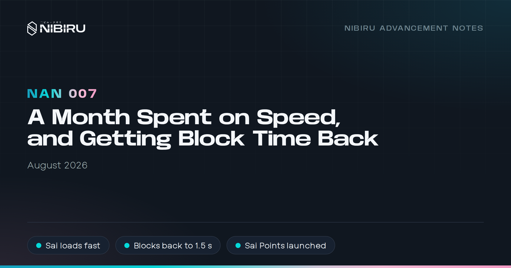
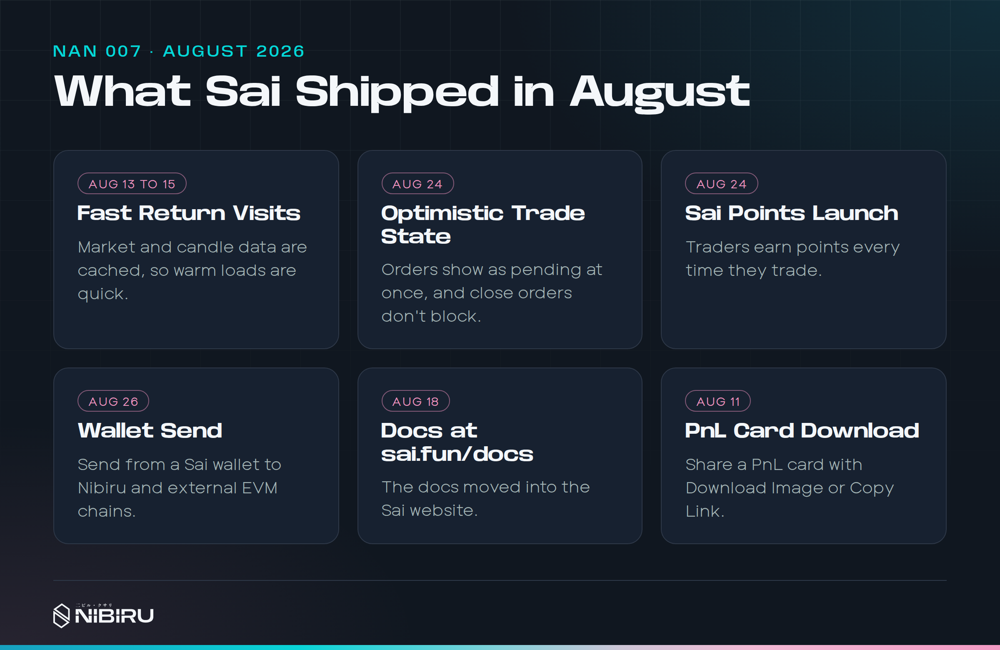
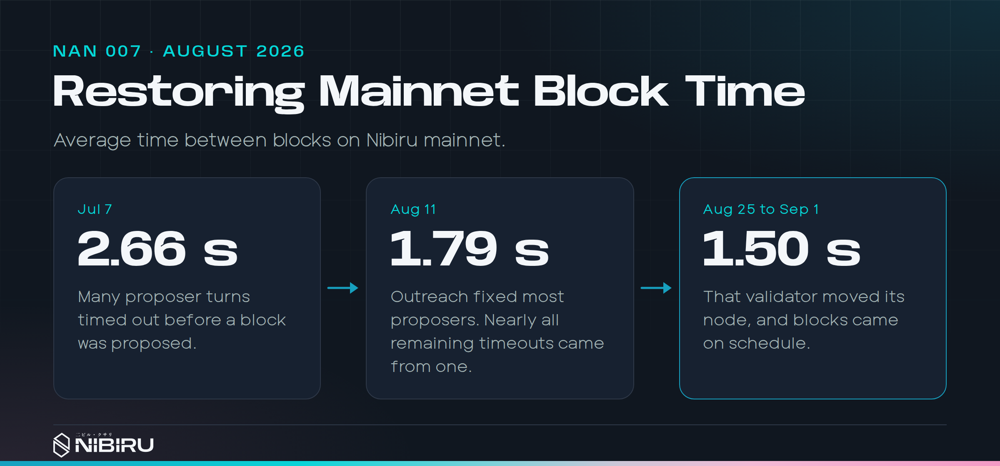

# NAN 007: A Month Spent on Speed, and Getting Block Time Back

*Posted by [Unique](https://uniquedivine.com/web3/nibiru/nibi-inc/) on 2026-08-31*. Prior mainnet upgrade: v2.17.0.

> *[NAN 006](./nan-006.md) < [Nibiru Advancement Notes (NANs)](./index.md) > [NAN 008](./nan-008.md)*



## Summary

* **We spent August on speed.** Engineering's one priority was making
  trading on Sai feel instant. Mobile waited.
* **Sai loads fast on return visits**, and your trade shows up the moment
  you click.
* **Mainnet blocks are back to about 1.5 seconds**, down from 2.66 in July.
  The fix was getting validators to propose blocks on time, not changing the
  chain.
* **Referral earnings follow the referral code**, not the wallet that owns
  it.
* **Sai Points launched** on August 24, and Sai's docs moved to
  sai.fun/docs.



## 1) A month with one priority

<!-- Sources:
- Double-open report, Jul 31: https://nibiruchain.slack.com/archives/C07LAL4Q5BR/p1785511353095079
- "Shared frame" status and model, Aug 5: https://nibiruchain.slack.com/archives/C07LAL4Q5BR/p1785946166207219
- Priority statements: Aug 8 https://nibiruchain.slack.com/archives/C07LAL4Q5BR/p1786207522406599
  Aug 14 https://nibiruchain.slack.com/archives/C07LAL4Q5BR/p1786727665652599
  Aug 18 https://nibiruchain.slack.com/archives/C07LAL4Q5BR/p1787073665197949
- Issues: sai-web #1106 to #1109, #1154, #1156, #1165, #1175, #1176, #1308, #1310
- August PRs: #1094 skeletons, #1098, #1110, #1147, #1155, #1157, #1170,
  #1172 intent journal, #1177, #1178 (HTTP vs WS timings), #1184, #1199
  RPC querier reuse, #1112 fresh balances after trade
- Later PRs: #1232 market switching (1,099-1,809 ms -> 79-122 ms),
  #1256 chain balance reads (mainnet p50 72 ms, p90 124 ms, 117 reads,
  0 mismatches; Keeper open confirm median 14.1 s), #1258, #1299,
  #1294 cached tables (lab p95 223.8 -> 35.2 ms, not used in copy),
  #1328, #1337
- Method docs: sai-web/docs/08-trading-table-performance.md,
  sai-web/docs/balance-reconciliation.md
- Interview, 26-11-02: over 90% of feedback is about speed; focus continued
  through October; Points ran in parallel.
-->

We talk to a lot of Sai traders. When we sort what they ask for, well over
90% of it comes back to one thing: speed. How long a trade takes to go
through after you click. How long before it shows up in your positions
table. Whether moving between screens feels sluggish. Feature requests and
bug reports come in too, but they're a small share next to that.

Plenty of traders already like Sai. Making it fast is how we make it better
for nearly all of them at once. Talking to users is how you find the one
problem worth focusing on, and this was it.

So in August, engineering worked on one thing, performance and smoothness.
Mobile and the native app waited.

The clearest example of the problem came on July 31, when a trader clicked
to open a position and ended up with two. The app didn't know whether the
first trade had gone through, so it let them try again. That double-open
showed us the real problem. When you trade, three separate things happen:

```text
sent       -> your wallet broadcast the transaction
included   -> a block on Nibiru contains it
indexed    -> the Sai Trading Engine has recorded it and the app can show it
```

The app had treated those as one moment. It waited for all three before it
showed anything, and it didn't remember that a trade was in flight. August's
work separated them:

* **No double submits.** A trade in flight locks its button until the app
  knows what happened.
* **Optimistic trade state.** Your order shows as pending the moment you
  click. A close shows "Closing…" until it's done, even across a refresh.
* **Cached market and candle data.** A return visit renders from cache
  first, then catches up. Live data still wins when it arrives.

The chart also gained volume and fill arrows, so you can see where you got
in and out.

This was also the month we started recording intents. An intent is a record
of each action a trader asked for, from request to result. Intents are what
made [one-click trading](https://sai.fun/blog/11-one-click-trading) possible
in October.

A lot of the slowness turned out to be the app's own data plumbing, not the
chain. In August we stopped it from fighting itself:

* **Healthy connections stay up.** The app was tearing down a working
  GraphQL socket at startup, and a quiet price stream reset every
  subscription about every 40 seconds, which made prices flicker.
* **Prices show before the socket connects.** On a cold start the app shows
  the last known prices, then fetches fresh ones over HTTP. In our
  measurements HTTP returned every price in about 240 ms, about half a
  second before the first WebSocket frame.
* **Pending trades survive a reload.** The record of a trade in flight lives
  in IndexedDB now, not in memory.

August was the start, not the whole job. The same focus carried through
September and October. If we'd kept picking up unrelated tickets, the core
problem would have improved so slowly that it might as well not have
improved at all.

Switching markets went from 1.1 to 1.8 seconds down to about 0.1, mostly
because the app stopped waiting on an analytics call. After a trade, Sai now
reads your balance straight from the chain in about a tenth of a second,
instead of waiting for the Sai Trading Engine to index it. On mainnet that
read took 72 ms at the median across 117 reads, with no mismatches. Switching between the Positions, Orders, and History tables is
now instant, because each table keeps its rows and shows them while it
refreshes.

The slowest step left is the wallet. MetaMask checks for a receipt every
four seconds, so a trade can sit finished on chain for a couple of seconds
before the app hears about it. That's next.

## 2) Getting block time back

<!-- Sources (boku epics/26-07-04-sai-gcloud-gcp/):
- 03-consensus-spike-analysis.md: timeouts are RoundStepPropose at 3000 ms
- 06-weekly-block-time-follow-up.md: Jul 7 2.662 s, Aug 11 1.790 s,
  Aug 25 to Sep 1 1.4955 s over 416,245 intervals
- 07-aug11-now-proposer-attribution.md: 99.7% of round-0 timeouts on one
  validator's turns, Aug 11 to 14
- 08-aug15-aknodes-status-cut.md, 11-mainnet-block-time-regression-runbook.md
- Validator is AKNodes; keep unnamed in public copy.
-->

Sai can only feel as fast as the chain under it. In early July, mainnet
averaged 2.66 seconds per block. A healthy Nibiru block takes about 1.5.



We didn't guess at the cause. We matched our validator's consensus logs
against which validator was scheduled to propose each block. The slow blocks
weren't slow to execute. The scheduled proposer never sent a block in time,
so the network waited out a 3-second timeout and moved on to the next round.

That made it an operations problem, not a code problem. We reached out to
the validators whose turns kept timing out. After the first round of fixes,
the daily average fell to 1.79 seconds by August 11. The remaining timeouts
came almost entirely from one validator's turns. That validator moved its
node on August 24, and from August 25 to September 1 mainnet averaged
1.50 seconds per block.

We didn't change Nibiru to get here. We got the network back to working the
way it already should. We turned the investigation into a runbook, so the
next time block time slips we can find the cause without starting over.

## 3) Gas estimates you can trust

<!-- Sources:
- nibiru#2424 (2025-11-03): simulate at max gas, smart lower bound, binary
  search. Code: nibi-chain/evm/evmstate/grpc_query.go EstimateGas.
- nibiru#2385: 63/64 gas clamp for ERC20 calls. nibiru#2516: dynamic
  precompile gas and OOG recovery.
- sai-web#1131 (Aug 12): trade 218 XAU close, estimates 2,178,072 vs
  1,672,826, 2x pad, 2.5M floor, 5M fallback. sai-web#1090, #1210.
-->

Before a wallet sends an EVM transaction, it calls `eth_estimateGas` to
decide how much gas to attach. Nibiru's estimate doesn't guess. Two chain
changes make it accurate.

The first is about precompiles. Ethereum's precompiles charge a fixed cost
based on the size of their input. Many of Nibiru's don't work that way. A
call into the Wasm precompile runs contract logic, and the bank and FunToken
precompiles move real balances, so the cost depends on what the call does.
Nibiru's precompiles now report dynamic gas, metered by the same Cosmos SDK
gas meter as everything else
([PR #2516](https://github.com/NibiruChain/nibiru/pull/2516)). The EVM sees
what each precompile call really used.

The second is the search. The estimator first simulates the transaction at
the highest allowed gas limit, and uses the gas that run consumed as its
lower bound. Then it binary-searches upward to the smallest limit that
succeeds ([PR #2424](https://github.com/NibiruChain/nibiru/pull/2424)).
Simulating first keeps the search short.

Run a simulation against Sai's contracts today and the estimate matches what
the transaction uses.

In August a Sai trader hit an edge case. A valid close ran out of gas inside
a precompile's token transfer, and estimates for the same close jumped
between two values about 505,000 gas apart. Sai's transactions run at zero
gas price, so an oversized limit costs the trader nothing. Sai now doubles its
estimates, with a floor of 2.5 million gas, instead of adding 10%, and the app no longer reports
out-of-gas deposits as successful.

<!-- Interview, 26-11-03: estimation is accurate now; the key change was
dynamic precompile gas aligned with the SDK gas meter (#2516, merged
2026-02-05). sai-web#1131's infinite-gas-meter diagnosis is unconfirmed;
keep it out of public copy. No chain follow-up after August found. -->

## 4) Referral earnings follow the code

<!-- Sources: sai-perps#363 (Jul 31), sai-perps#395 (Aug 7, motivation
quoted), sai-keeper#471, sai-keeper#491 (Aug 7; revert #490, relanded same
day). Contracts deployed to mainnet Aug 11 to 12. -->

Referral earnings on Sai attach to a referral code, and a code can change
owners. The old indexer inferred referral earnings
from wallet history and from the code recorded when a trade opened. That
breaks when a code changes hands, or when a long-lived trade's active code
changes. Now the code is the identity. Volume and revenue belong to the
code that was active when they happened, and a new owner inherits the code
without rewriting its history.

Every referral event from the contract now carries both the change and the
running total. If the Sai Trading Engine misses an event or replays a range,
the next total puts it back on the right number.

## 5) Sai Points, and docs in one place

<!-- Sources: sai-web#1191 (Points, Aug 24); scope meeting Aug 20
https://nibiruchain.slack.com/archives/C07LAL4Q5BR/p1787324667466759 ;
Gitbook cancel Aug 24
https://nibiruchain.slack.com/archives/C03DD94GR8W/p1787607928486389 ;
sai-web#1185 docs move. -->

Sai Points launched on August 24. Traders earned points for trading volume
and weekly streaks through Season 1, which ran until October 4. The
[launch post](https://sai.fun/blog/09-sai-points) has the rules, and the
[Season 1 rewards post](https://sai.fun/blog/12-sai-points-season-1-rewards)
covers how rewards were decided.

Points launching in a month we'd set aside for speed isn't a contradiction.
Engineering focused on performance, while marketing and business development
ran Points in parallel. Neither took anything from the other.

The same day, we stopped paying for Gitbook. Sai's documentation now lives
at sai.fun/docs, next to the app. The site, the docs, and the app now share one
domain and one codebase, so a link from a trading screen to the page that
explains it stays inside Sai.

## 6) Also on Sai in August

<!-- Sources: Wallet Send sai-web#958 (Aug 26; USDT in #1218, Sep 1).
Others from notes-shipped-sai-2026.md, August section. -->

* **Wallet Send** lets you send from your Sai wallet to Nibiru and other EVM
  chains.
* PnL cards download as an image or share as a link.
* Fee tiers now count dollar volume.
* Direct USDC withdrawals, with bridging and withdrawing as separate steps.
* A 1% maximum slippage on opens.
* A feedback form inside the app.

## References

Pull requests behind each section. The Sai repositories are private, so the
text above describes each change on its own.

**1) A month with one priority**

* [sai-web#1098](https://github.com/NibiruChain/sai-web/pull/1098): Prevent
  duplicate trade submissions.
* [sai-web#1184](https://github.com/NibiruChain/sai-web/pull/1184):
  Optimistic trade state, pending display, and non-blocking closes.
* [sai-web#1110](https://github.com/NibiruChain/sai-web/pull/1110): Reconcile
  position closes durably.
* [sai-web#1094](https://github.com/NibiruChain/sai-web/pull/1094): Loading
  skeletons.
* [sai-web#1147](https://github.com/NibiruChain/sai-web/pull/1147): Cache
  market and candle data for warm loads.
* [sai-web#1172](https://github.com/NibiruChain/sai-web/pull/1172): Trading
  intents, reported through the Sai Trading Engine.
* [sai-web#1170](https://github.com/NibiruChain/sai-web/pull/1170): IndexedDB
  outbox for pending trades.
* [sai-web#1155](https://github.com/NibiruChain/sai-web/pull/1155) and
  [sai-web#1157](https://github.com/NibiruChain/sai-web/pull/1157): Stop
  restarting quiet subscriptions and tearing down the socket at startup.
* [sai-web#1177](https://github.com/NibiruChain/sai-web/pull/1177) and
  [sai-web#1178](https://github.com/NibiruChain/sai-web/pull/1178): Load
  market data and prices over HTTP first, with the HTTP and WebSocket
  timings.
* [sai-web#1199](https://github.com/NibiruChain/sai-web/pull/1199): Reuse
  RPC queriers across subscription updates.
* [sai-web#1112](https://github.com/NibiruChain/sai-web/pull/1112): Fresh
  balances after a trade.
* [sai-web#1232](https://github.com/NibiruChain/sai-web/pull/1232): Market
  switching from 1.1 to 1.8 seconds down to about 0.1.
* [sai-web#1256](https://github.com/NibiruChain/sai-web/pull/1256),
  [sai-web#1258](https://github.com/NibiruChain/sai-web/pull/1258), and
  [sai-web#1299](https://github.com/NibiruChain/sai-web/pull/1299): Read
  balances from the chain right after a trade, and keep them consistent
  until the Sai Trading Engine catches up.
* [sai-web#1294](https://github.com/NibiruChain/sai-web/pull/1294): Trading
  tables that keep their rows while they refresh.
* [sai-web#1328](https://github.com/NibiruChain/sai-web/pull/1328) and
  [sai-web#1337](https://github.com/NibiruChain/sai-web/pull/1337): Cut
  repeated RPC reads, and reconnect the block socket once.

**3) Gas estimates you can trust**

* [nibiru#2516](https://github.com/NibiruChain/nibiru/pull/2516): Dynamic
  precompile gas, metered by the SDK gas meter.
* [nibiru#2424](https://github.com/NibiruChain/nibiru/pull/2424): Simulate
  first, then binary-search the gas limit.
* [sai-web#1131](https://github.com/NibiruChain/sai-web/pull/1131): Pad Sai
  gas limits against unstable precompile estimates.

**4) Referral earnings follow the code**

* [sai-perps#363](https://github.com/NibiruChain/sai-perps/pull/363): Key
  referral fees by code.
* [sai-perps#395](https://github.com/NibiruChain/sai-perps/pull/395):
  Lifetime referral totals in every referral event.
* [sai-keeper#491](https://github.com/NibiruChain/sai-keeper/pull/491):
  Apply referral events idempotently and track code ownership changes.

**5) Sai Points, and docs in one place**

* [sai-web#1191](https://github.com/NibiruChain/sai-web/pull/1191): Launch
  Sai Points.
* [sai-web#1185](https://github.com/NibiruChain/sai-web/pull/1185): Build
  Sai's docs into the website.

**6) Also on Sai in August**

* [sai-web#958](https://github.com/NibiruChain/sai-web/pull/958): Wallet
  Send.
