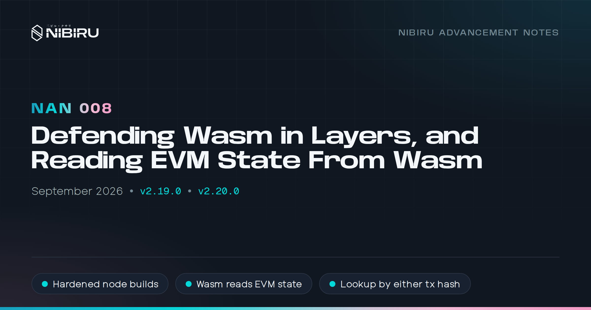
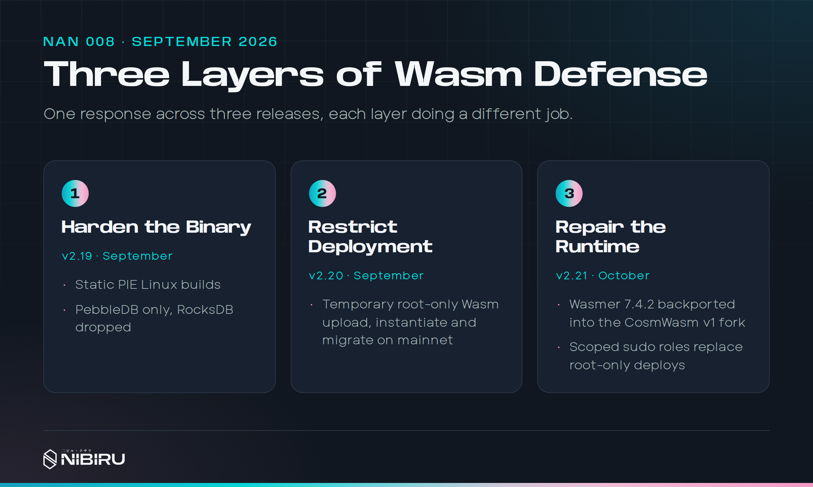
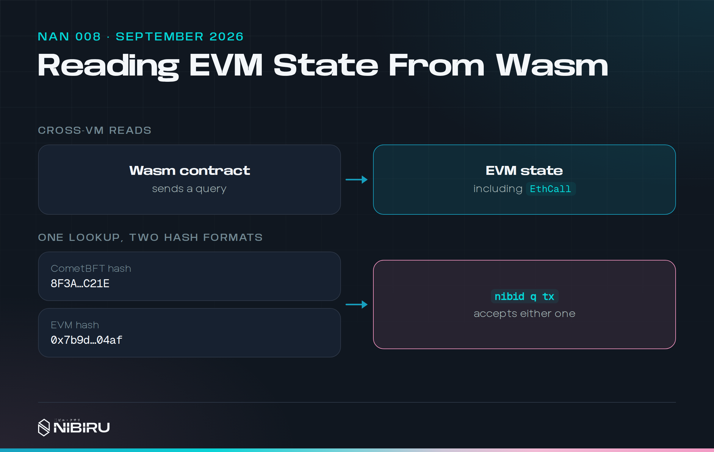

# NAN 008: Defending Wasm in Layers, and Reading EVM State from Wasm

*Posted by [Unique](https://uniquedivine.com/web3/nibiru/nibi-inc/) on 2026-09-30*. Releases: v2.19.0, v2.20.0. Prior mainnet upgrade: v2.18.1.

> *[NAN 007](./nan-007.md) < [Nibiru Advancement Notes (NANs)](./index.md)*

## Summary

* **A Wasm runtime vulnerability** was disclosed to us privately. It's now
  public as [CWA-2026-006](https://github.com/CosmWasm/advisories/blob/main/CWAs/CWA-2026-006.md).
* **v2.19 made the node binary harder to exploit.** Release builds are
  static PIE binaries, which load at a random address, and use PebbleDB
  only.
* **v2.20 restricted who can deploy Wasm** on mainnet while we prepared the
  runtime repair.
* **The runtime repair** shipped in October with v2.21.
* **Wasm contracts can read EVM state**, including simulated `eth_call`
  results.
* **One command finds any transaction.** `nibid q tx` accepts a CometBFT or
  an EVM hash.
* **Sai shows what you pay.** Every position shows its borrowing fee, and
  PnL is shown after fees.

## 1) Three layers, because no single layer was enough

<!-- Sources:
- Advisory: https://github.com/CosmWasm/advisories/blob/main/CWAs/CWA-2026-006.md
  (public 2026-09-28).
- CHANGELOG.md v2.19.0 section 2, v2.20.0 sections 2 and 3, v2.21.0
  section 2.
- Mainnet: v2.19.0 h 45,830,488 (prop 35), v2.20.0 h 46,828,562
  (2026-09-26, prop 36), v2.21.0 h 47,668,356 (2026-10-11, prop 38).
- Repair: https://github.com/NibiruChain/nibiru/pull/2788 (merged
  2026-10-07), Wasmer 7.4.2.
- boku epics/26-09-06-security/README.md. Public copy stays at CHANGELOG
  level: no disclosure timing or validator coordination.
-->

A defect in Wasmer's Singlepass compiler was disclosed to us privately.
Singlepass is the compiler CosmWasm uses to turn contract code into machine
code. A crafted contract could escape the Wasm sandbox and run native
instructions inside the node. The advisory describes the result:
unauthorized minting and permanent loss of funds.

The real fix was a new runtime. That takes time to build, test, and roll out
to every validator, so we didn't wait for it. We stacked three layers and
shipped each one when it was ready:

1. **Harden the binary** (v2.19). This makes an escape harder to use.
2. **Restrict deployment** (v2.20). This makes it harder to get a malicious
   contract on chain.
3. **Repair the runtime** (v2.21, in October). This removes the defect.

Neither of the first two fixes the bug, and we said so in the changelog. Each
one narrows what an attacker can do until the next lands.

## 2) Layer one: static PIE, and dropping RocksDB

<!-- Sources:
- CHANGELOG.md v2.19.0 sections 1 to 4. Build:
  nibi-chain/contrib/scripts/build-nibiru.sh (at tag v2.19.0).
- Release tags: https://github.com/NibiruChain/nibiru/releases/tag/hotfix/v2.19.0,
  https://github.com/NibiruChain/nibiru/releases/tag/v2.19.0
  (source commit 970841fe).
- https://github.com/NibiruChain/nibiru/pull/2750 (merged 2026-09-06),
  Bookworm builders; nibiru#2749 (2026-09-06) deps.
- boku epics/26-09-06-security/02-private-release-and-wasm-admission.md
-->

Our Linux release binary was statically linked, but it loaded at a fixed
address. That makes exploits easier, because an attacker knows where the
code lives. v2.19 builds a static position-independent executable (PIE),
so the operating system can place it at a random address on each run. Release
checks now verify that property in the finished binary rather than trusting
compiler flags.

Static PIE has a cost: every native library linked into the binary has to be
built for it. RocksDB is a C++ library, and making it work would have meant a
separate native build path in the middle of a security response. So the
published builds dropped RocksDB and use PebbleDB only.

That was an easy call, because RocksDB was already on its way out. On paper
it's faster than Go's LevelDB and a good fit for running a node. In
production, it wasn't. Operators hit memory problems deep inside its C code.
PebbleDB is pure Go, so Go's garbage collector manages its memory. When
something needs changing, we update one Go dependency instead of patching
low-level C. We ran both in production, and Pebble was the more stable one.

The only other reason to keep RocksDB was our own indexer, which used to read
RocksDB files directly. Heart Monitor moved to PebbleDB too. After that,
RocksDB was build complexity with nothing depending on it. PebbleDB had been
the default for a long time, and our snapshots and state sync already ran on
it. v2.19 finished the move. No one on the network runs RocksDB anymore.

<!-- Sources and interview, 26-11-03:
- Removal tracked in https://github.com/NibiruChain/nibiru/issues/2432.
  PebbleDB support nibiru#1818, default nibiru#1908, tests nibiru#1979.
- Memory issues: https://github.com/NibiruChain/nibiru/issues/1788
  ("Node is always oom", 2024-02). Pebble's stability is from running both
  in production, not from a design comparison.
- Heart Monitor (nibi-go-hm) moved its direct DB reads to PebbleDB.
- Source builds can still opt into RocksDB with the `rocksdb` build tag.
-->

v2.19 shipped as verified binaries first, and the public source followed.

We moved the Wasm VM's release builders from Debian Bullseye to Bookworm in
the same stretch. Bullseye reached end of life on August 31, and its package
mirrors started failing our CI ([PR #2750](https://github.com/NibiruChain/nibiru/pull/2750)).

## 3) Layer two: a temporary deployment guard

<!-- Sources:
- https://github.com/NibiruChain/nibiru/pull/2762 (merged 2026-09-21);
  also validates delegated permission members as Bech32.
  Code: nibi-chain/x/wasm/keeper/options.go WithWasmDeployerGuard.
- CHANGELOG.md v2.20.0 sections 2 and 3; v2.21.0 section 3 (scoped roles).
- boku epics/26-09-06-security/03-v2-20-wasm-upload-allowlist.md
-->

v2.20 limits Wasm code upload, instantiation, and migration on mainnet to the
current root of the `x/sudo` module, plus existing governance
authorization ([PR #2762](https://github.com/NibiruChain/nibiru/pull/2762)).

Where the check sits mattered most. A Wasm deployment can arrive as a normal
message, as a submessage from another contract, or through the EVM's Wasm
precompile. We put the guard in the shared keeper entry points that all three
go through. Adding it to the message handlers alone would have left two doors
open.

The guard doesn't stop contracts already on chain from running, and it
doesn't touch execution or queries. Root-only deployment was also a blunt
instrument by design. In October, v2.21 replaced it with scoped roles. A
deployer role can deploy without holding every other sudo power.

## 4) Wasm contracts can read EVM state

<!-- Sources:
- https://github.com/NibiruChain/nibiru/pull/2775 (merged 2026-09-23):
  adds account, balance, storage, code, params, base fee, token mapping,
  estimate gas, validator account, and EthCall routes; MsgEthereumTx stays
  rejected. Code: nibi-chain/app/wasmext/stargate_query.go
  WasmAcceptedStargateQueries.
- CHANGELOG.md v2.20.0 section 4.
-->

A Wasm contract can query other modules only through an allowlist of
Stargate query paths. Nibiru's EVM already served read queries over gRPC,
but those paths weren't on the list, so Wasm calls to them failed. v2.20
adds them ([PR #2775](https://github.com/NibiruChain/nibiru/pull/2775)). A Wasm contract
can now read EVM accounts, balances, storage, code, parameters, and FunToken
mappings.

The most useful one is `EthCall`. A Wasm contract can simulate a call to an
EVM contract and read the result without committing anything. Wasm apps can
now use data that only an EVM contract exposes. They still can't send EVM
transactions. The Wasm message handler keeps rejecting those.

## 5) One command for either hash

<!-- Sources:
- https://github.com/NibiruChain/nibiru/pull/2783 (merged 2026-09-24):
  --details flag, query-mode config, EVM JSON-RPC fallback.
  Code: nibi-chain/x/cli/impl/txhash.go ClassifyTxHash,
  x/cli/impl/query_tx.go.
- CHANGELOG.md v2.20.0 section 5.
-->

A Cosmos transaction has a CometBFT hash. An Ethereum transaction has an EVM
hash. If you're chasing a cross-VM issue, you shouldn't have to know which one
your tool wants. `nibid q tx` now accepts either. For EVM activity, it links
the EVM transaction to its CometBFT record ([PR #2783](https://github.com/NibiruChain/nibiru/pull/2783)).

## 6) Owning distribution

<!-- Sources:
- nibiru#2751 (merged 2026-09-07) images, nibiru#2756 (2026-09-14) npm,
  nibiru#2754 (2026-09-08) Rust workspace, nibiru#2757 (2026-09-16) Bun,
  nibiru#2763 (2026-09-19) Make retired. Go 1.27: nibiru#2776
  (2026-09-23).
- CHANGELOG.md v2.20.0 section 7.
- boku epics/26-08-26-nibi-chain/01-go-cli-npm-26-05-05.md
-->

Release binaries now feed npm packages and AMD64 and ARM64 container images
directly, with checksums verified at each step ([PR #2751](https://github.com/NibiruChain/nibiru/pull/2751),
[PR #2756](https://github.com/NibiruChain/nibiru/pull/2756)). The Rust contract
workspace moved into the chain repository, and its test suite now runs in
the chain's CI ([PR #2754](https://github.com/NibiruChain/nibiru/pull/2754)),
continuing what [NAN 006](./nan-006.md) started. The repository switched from
Make to Just, and the Go baseline moved to 1.27
([PR #2776](https://github.com/NibiruChain/nibiru/pull/2776)).

## 7) On Sai: knowing what you pay

<!-- Sources (notes-shipped-sai-2026.md, September; sai-web is private):
- Borrowing fee column, PnL after fees: sai-web#1240 (09-21).
- Points leaderboards: sai-web#1214 (09-02), #1246. boku
  epics/26-10-21-sai-points/README.md
- USDT sends: sai-web#1218 (09-01). EIP-6963: #1215, #1250.
- stNIBI retired: sai-web#1244 (09-21). boku
  epics/26-07-31-sai-perf-trade-ui-lag/09-stnibi-sunset.md
-->

* **Borrowing fees on every position**, and PnL shown after fees, so the
  number you see is the number you'd get.
* **Points leaderboards**, by season and by week.
* **USDT sends** on external chains from Wallet Send.
* **stNIBI collateral retired.** Sai trades in USDC only.
* **Wallet approvals in mobile in-app browsers** work through EIP-6963.

Retiring stNIBI is the kind of change we like making. We added it so Sai
could use liquidity already on Nibiru, like staked NIBI, to help early
growth. Traders didn't want it. stNIBI was under 1% of Sai's volume and
collateral value, and everyone else used USDC.

Supporting a second collateral wasn't cheap. To value it, Sai needed its
price across all of history. Accounting had to convert it to dollars, and a
lot of contract state was keyed by collateral as well as by market. With
USDC alone, Sai can treat a dollar as a dollar, the way centralized exchanges
do. The code is simpler and has fewer places for bugs.

Collateral was never the right job for stNIBI anyway. Look at BNB on
Binance. Futures there settle in USDT, not BNB. BNB earns its place through
holder benefits instead: hold or stake enough and you get lower trading fees
and rebates. That's the better model for stNIBI on Sai. Its value should come
from benefits for holding it, not from forcing it into the trading path,
where it made things harder for us and did nothing for traders.

That's what talking to users is for. It tells you what to build, and it also
tells you what to remove. Cutting a feature nobody uses is part of the job.

<!-- Interview, 26-11-03: stNIBI was <1% of volume and value. Original idea
was to use on-chain liquidity (stNIBI, and MIM at the time) for early
growth. Multi-collateral meant historical pricing, dollar accounting, and
composite state keys by collateral index. Better model: holder benefits
(fee discounts, rebates) like BNB on Binance, not collateral. Keep
MIM/Abracadabra out of copy.
Say retire/cleanup, never "drain". -->

## What's next

October finishes the Wasm response with Wasmer 7.4.2 and scoped sudo roles in
v2.21. It also brings the consensus engine in-tree as Nibiru BFT, and
one-click trading on Sai. That's the next note.

## References

Pull requests behind each section. The Sai repositories are private, so the
text above describes each change on its own.

**1) Three layers**

* [CWA-2026-006](https://github.com/CosmWasm/advisories/blob/main/CWAs/CWA-2026-006.md):
  The public advisory.
* [nibiru#2788](https://github.com/NibiruChain/nibiru/pull/2788): The
  runtime repair, Wasmer 7.4.2, shipped in v2.21.

**2) Layer one: static PIE, and dropping RocksDB**

* [nibiru#2750](https://github.com/NibiruChain/nibiru/pull/2750): Bookworm
  release builders.
* [nibiru#2749](https://github.com/NibiruChain/nibiru/pull/2749): Dependency
  updates.
* [nibiru#2432](https://github.com/NibiruChain/nibiru/issues/2432): Remove
  RocksDB in favor of PebbleDB.
* [nibiru#1788](https://github.com/NibiruChain/nibiru/issues/1788): Memory
  problems running a full node.

**3) Layer two: a temporary deployment guard**

* [nibiru#2762](https://github.com/NibiruChain/nibiru/pull/2762): Limit Wasm
  upload, instantiation, and migration on mainnet.

**4) Wasm contracts can read EVM state**

* [nibiru#2775](https://github.com/NibiruChain/nibiru/pull/2775): EVM query
  routes on the Wasm Stargate allowlist, including `EthCall`.

**5) One command for either hash**

* [nibiru#2783](https://github.com/NibiruChain/nibiru/pull/2783): `nibid q
  tx` accepts CometBFT or EVM hashes.

**6) Owning distribution**

* [nibiru#2751](https://github.com/NibiruChain/nibiru/pull/2751): Container
  images from release binaries.
* [nibiru#2756](https://github.com/NibiruChain/nibiru/pull/2756): npm
  packages from release binaries.
* [nibiru#2754](https://github.com/NibiruChain/nibiru/pull/2754): The Rust
  contract test suite moves into the chain repo.
* [nibiru#2776](https://github.com/NibiruChain/nibiru/pull/2776): Go 1.27
  baseline.
* [nibiru#2757](https://github.com/NibiruChain/nibiru/pull/2757) and
  [nibiru#2763](https://github.com/NibiruChain/nibiru/pull/2763): Bun
  tooling, and Make retired for Just.

**7) On Sai**

* [sai-web#1240](https://github.com/NibiruChain/sai-web/pull/1240): Fees
  and PnL reported as what a trade paid and kept.
* [sai-web#1214](https://github.com/NibiruChain/sai-web/pull/1214) and
  [sai-web#1246](https://github.com/NibiruChain/sai-web/pull/1246): Points
  leaderboards by season and week.
* [sai-web#1218](https://github.com/NibiruChain/sai-web/pull/1218): USDT
  sends on external chains.
* [sai-web#1244](https://github.com/NibiruChain/sai-web/pull/1244): Retire
  stNIBI collateral.
* [sai-web#1215](https://github.com/NibiruChain/sai-web/pull/1215) and
  [sai-web#1250](https://github.com/NibiruChain/sai-web/pull/1250): Wallet
  approvals in mobile in-app browsers.
